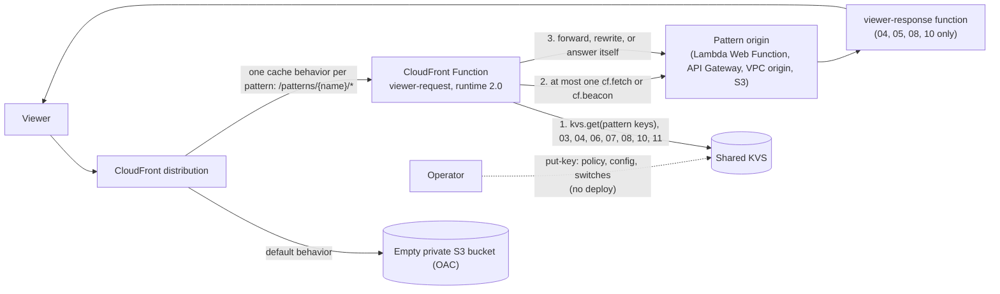

# Deploy, operate and tear down

## Architecture



- **One stack, `FoundationStack`.** It owns the distribution (HTTP/2 and HTTP/3), an empty private bucket on the
  default behavior (any path outside `/patterns/<name>/*` answers 403) and the shared KVS. It discovers every `patterns/<nn>-<name>/` folder and creates the pattern's backend, its
  CloudFront Function(s) and its cache behavior under `/patterns/<name>/*`.
- **AWS WAF.** Patterns may contribute rules to one shared web ACL on the distribution (default action Allow, every rule
  scoped to its pattern's path). Today only [11](../patterns/11-edge-waiting-room/) does: Bot Control (count), a
  CAPTCHA on the first visit and a silent challenge after it; billed per web ACL, rule, inspected request and challenge or
  CAPTCHA attempt (each solved puzzle is a billed CAPTCHA).
- A function may only call an origin configured on the same distribution. Patterns that call something viewers never hit
  (Cognito, a secondary Lambda, a mirror bucket) add it as an extra origin with no cache behavior.

## Deploy

Prerequisites: Node.js 22+, AWS credentials in your shell (for example `AWS_PROFILE=...`), and Docker or npm for Lambda
bundling. No account id is in the code; CloudFront Functions and KVS live in `us-east-1`.

```sh
npm ci                                           # also installs each pattern origin's dependencies
npx cdk bootstrap aws://<account-id>/us-east-1   # once per account
npm run deploy                                   # cdk deploy
```

To deploy only some patterns, list their ids:

```sh
npx cdk deploy -c patterns=hello-fetch,agent-authz
```

Every resource is tagged `project=cloudfront-functions-network-call-patterns`. To add your own tags to every resource, pass
them as context: `npx cdk deploy -c tags='{"team":"edge"}'`, or set `"tags"` under `"context"` in `~/.cdk.json`.

## The KVS keys

Seven patterns read the shared KVS: settings an operator changes with no deploy, or keys a pattern's own Lambda writes. The
others make their call on every request and need no key.

| Key | Used by | Values | Default when missing |
|---|---|---|---|
| `bot-policy` | [03](../patterns/03-bot-check-fail-open/) | `block` \| `tag` \| `off` | `tag` |
| `<uid>` (16 hex) | [04](../patterns/04-ab-global-table/) | `A` \| `B`, written by the pattern's Lambdas | miss: one call to assign |
| `routing-kill-switch` | [06](../patterns/06-vpc-private-routing/) | `off` skips the routing call | routing on |
| `cfg-<key>` | [07](../patterns/07-kvs-config-plus-fetch/) | `{"exp":<epoch s>,"config":{...}}`, written and deleted by the pattern's promoter for hot keys | miss or expired: one call to the origin |
| `health-probe` | [08](../patterns/08-origin-health-fallback/) | `on` \| `off` | `off`: no probe |
| `md:<uri>` | [10](../patterns/10-markdown-on-demand/) | the `.md` URI, written by the pattern's worker | miss: HTML and one beacon |
| `queue-mode`, `queue-epoch` | [11](../patterns/11-edge-waiting-room/) | `on` \| `off`; a positive integer that starts a new line. Read by the admission Lambda | `on`, `1` |
| `queue-state` | [11](../patterns/11-edge-waiting-room/) | `{"mode","epoch","serving","step","tick"}`, written by the admission Lambda once a minute | "starting" page, no ticket |
| `queue-secret-cur`, `queue-secret-prev` | [11](../patterns/11-edge-waiting-room/) | HMAC secrets for the queue cookies; the Lambda writes the first `cur` | no `cur`: "starting" page |

Every deploy creates a new, empty KVS under a new name (`FoundationStack-kvs-<deploy id>`) and deletes the old one, so a store left behind by an earlier deployment never blocks a deploy. A redeploy therefore resets every key: the functions fall back to the defaults in the table, the caches refill and the admission Lambda rewrites `queue-state` within a minute. Put back any setting you changed after each deploy.

Write a key. The store ARN is the `KeyValueStoreArn` output of `FoundationStack`; a write takes about 30-60 s to reach the edge (measured 2026-10-27).

```sh
KVS_ARN=$(aws cloudformation describe-stacks --stack-name FoundationStack \
  --query "Stacks[0].Outputs[?OutputKey=='KeyValueStoreArn'].OutputValue" --output text)
ETAG=$(aws cloudfront-keyvaluestore describe-key-value-store --kvs-arn "$KVS_ARN" --query ETag --output text)
aws cloudfront-keyvaluestore put-key --kvs-arn "$KVS_ARN" --key health-probe --value on --if-match "$ETAG"
```

## Verify

- **curl.** Every pattern README has a **Try it** section with the commands and the expected answer.
- **Unit tests and checks.**

  ```sh
  npm run build                    # type-check the CDK app
  npm test                         # function checks, every unit test, then the infra synth test
  (cd patterns/04-ab-global-table/lambda && npm test)   # the stream consumer's own tests
  ```

## Server-Timing

Every behavior (the default one and each `/patterns/<id>/*`) has a response headers policy with CloudFront's
[`Server-Timing` header](https://docs.aws.amazon.com/AmazonCloudFront/latest/DeveloperGuide/understanding-response-headers-policies.html#server-timing-header)
enabled, at a sampling rate of 100 so every **Try it** has timings. The header is a few hundred bytes per response and
costs nothing extra; in production set a low rate (1 to 10 percent) in `SERVER_TIMING_SAMPLING_RATE`
(`infra/lib/foundation-stack.ts`), and send `Pragma: server-timing` to get it on any one request regardless of the rate.

```sh
curl -sI "https://$DOMAIN/patterns/hello-fetch/" | grep -i server-timing
```

A browser page served from the same distribution reads the header with `fetch()`, and
`PerformanceResourceTiming.serverTiming` is populated without `Timing-Allow-Origin`. A page on another origin needs
`Timing-Allow-Origin` for `serverTiming`, and `Access-Control-Expose-Headers: Server-Timing` to read it from `fetch()`.

The metrics describe CloudFront's own work: cache result, POP, request id, origin DNS, connect and first-byte latency.
They do not split out the function or its `cf.fetch` calls, and the function cannot add its own entries: `Date.now()`
does not advance across an awaited `cf.fetch`, so there is nothing to measure with.

## Tear down

- **One pattern.** Deploy without it (delete its folder, or leave it out of `-c patterns=...`); its behavior, function
  and backend are deleted in the same deploy.
- **Everything.** `npx cdk destroy` deletes the stack: the distribution, the KVS, every pattern's backend and the
  default-behavior bucket. Disabling and deleting the distribution takes several minutes.
