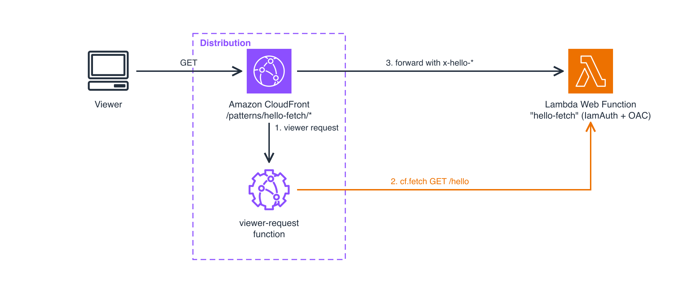
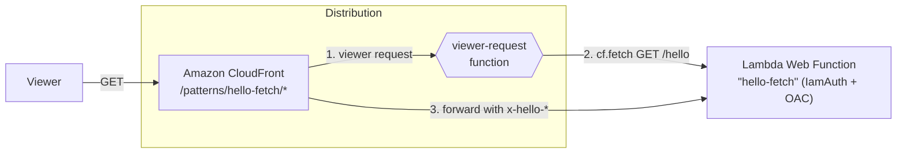
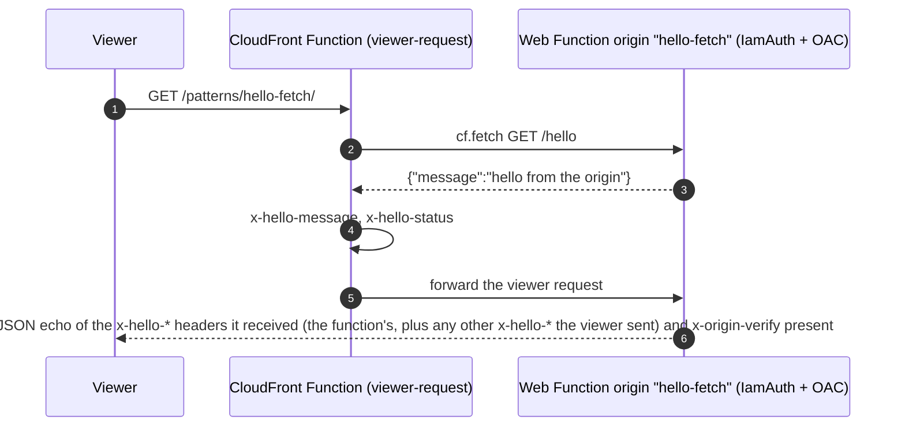

# 00 · hello-fetch

The smallest round trip: one `cf.fetch` GET to the pattern's own origin, one JSON field copied into a request header.

Tags: none · Hooks: viewer-request · Path: `/patterns/hello-fetch/*`

## What it does

The function GETs `/hello` on its origin, a Fastify server on a Lambda Web Function, and copies one JSON field into a request header the origin
echoes back. It is the template for every other pattern and proves the wiring: behavior, function association, origin id,
and that the call passes the origin's access control (OAC). It fails open: if the call fails, the request still goes through.

## Architecture





## Sequence diagram



## The function

Key points:

- The origin id is the `originId` set in `pattern.ts`; the contract enforces that it equals the folder id. `method` defaults
  to `GET`.
- `includeBody: true` because the body is read; it defaults to `false`.
- One `catch` for everything: `e.name + ': ' + e.message` goes into `x-hello-error`.

The viewer-request function: [`function.js`](function.js).

## Prerequisites

Node.js 22+, AWS credentials for the target account, Docker or npm for Lambda bundling, and a CDK-bootstrapped
`us-east-1` (`npx cdk bootstrap aws://<account-id>/us-east-1`). Run `npm ci` once at the repository root.

## Deploy this pattern

```sh
npx cdk deploy -c patterns=hello-fetch
```

This deploys the one stack with only this pattern's backend and cache behavior. The `DistributionDomain` output is the
`<domain>` used below. To deploy it next to others, list them: `-c patterns=hello-fetch,agent-authz`.

## Try it

```sh
curl -s https://<domain>/patterns/hello-fetch/
```

`headersFromFunction.x-hello-message` is `"hello from the origin"` and `x-hello-status` is `200`.

## How it fails

| What you see | Meaning |
|---|---|
| `x-hello-message: hello from the origin` | the call worked and passed the origin's OAC check |
| `x-hello-status: 403` while the direct request still works | the call did not pass the origin lock (OAC or the `x-origin-verify` header) |
| `x-hello-error: TypeError: ...` | the call is invalid (bad option, unknown origin id), or `... could not be completed due to <result type>`: the edge could not reach the origin (DNS, TLS, connection); the request was still forwarded |
| `x-hello-error: TimeoutError: ...` or `InternalError: ...` | the origin did not answer within 1 s, or the call failed; the request was still forwarded |
| `x-hello-error: SyntaxError: ...` | the origin answered something that is not JSON |

## Cost

You pay for what a request uses: one CloudFront request, one CloudFront Functions invocation, one network call, and one
Lambda invocation each for the call and the forwarded request. The secret is one Secrets Manager secret. Nothing runs
when there is no traffic. See [CloudFront pricing](https://aws.amazon.com/cloudfront/pricing/),
[Lambda pricing](https://aws.amazon.com/lambda/pricing/) and
[Secrets Manager pricing](https://aws.amazon.com/secrets-manager/pricing/).

## Security

- The origin is a Lambda Web Function with an `IamAuth` endpoint behind origin access control (OAC, origin type `lambda`,
  signing `always-amz-auth`). Its resource policy lets only CloudFront, for this distribution, invoke the endpoint; a
  direct request to the endpoint domain is refused with 403.
- CloudFront adds a secret `x-origin-verify` header on every origin request, the network call included; the origin refuses
  `/hello` without it.
- The function deletes viewer-supplied `x-hello-message`, `x-hello-status` and `x-hello-error` before the call, so the
  origin only sees the values the function set for those three. Other viewer `x-hello-*` headers still pass, and the echo
  shows them next to the function's.
- **The shared origin secret is a second lock, and it is visible.** CDK unwraps it at deploy time, so its value is in the
  CloudFormation template, the origin's environment and the distribution's custom-header configuration. The origin is
  already locked by IAM auth and origin access control. For production, pass only the secret's ARN to the origin and
  read the value at run time with a scoped read grant, and rotate the secret together with the CloudFront header.

## Limits and notes

- OAC signs each origin request, the `cf.fetch` call included. For `POST`, `PUT` and `PATCH` CloudFront signs with an
  unsigned payload, so neither the function nor a viewer needs to send `x-amz-content-sha256`. The origin also refuses
  `/hello` without the secret `x-origin-verify` custom header, so a `200` proves the call carries the origin's custom
  headers.
- The origin is a plain Fastify app (`lambda/app.mjs`): a Web Function runs any Node.js HTTP server on port 3000, so the
  same code runs locally with `node lambda/index.js`.

Files:

- `pattern.ts`: the contract export (`id`, `functionCode`, `origin(scope, ctx)`)
- `function.js`: the CloudFront Function
- `lambda/app.mjs`: the origin, a Fastify app (`/hello` and the echo); `lambda/index.js` starts it on port 3000
- `test/function.test.mjs`, `test/origin.test.mjs`: unit tests, `node --test patterns/00-hello-fetch/test/*.test.mjs`
- `demo.json`: the demo card
- `architecture.png`: drawn from the Mermaid block under Architecture by `npm run diagrams`

## Clean up

```sh
npx cdk destroy
```

This deletes the stack: the distribution, the KVS, this pattern's Web Function and secret, and the demo bucket.

The Web Function's log group belongs to the stack and is deleted with it. Log groups the stack did not create outlive it:
the `<log group>.local` group the Web Function service adds next to it,
a plain Lambda function's `/aws/lambda/<function>`, created on first use, and the CloudFront Functions logs
`/aws/cloudfront/function/<function>` in `us-east-1`. Delete them by hand if you do not want to keep the logs.
