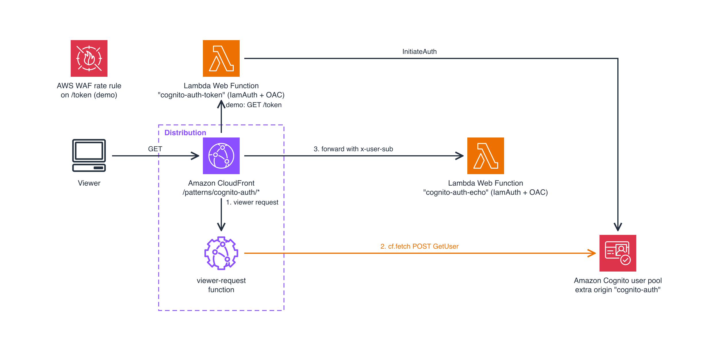
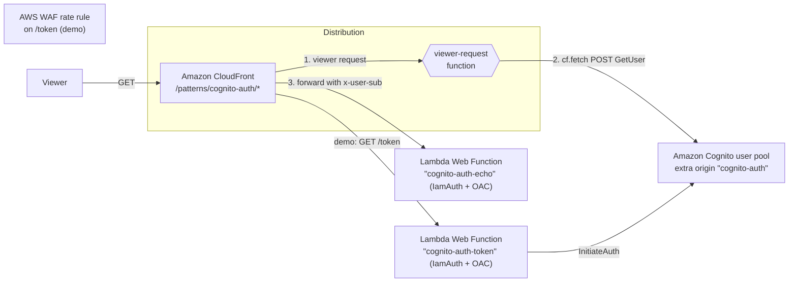
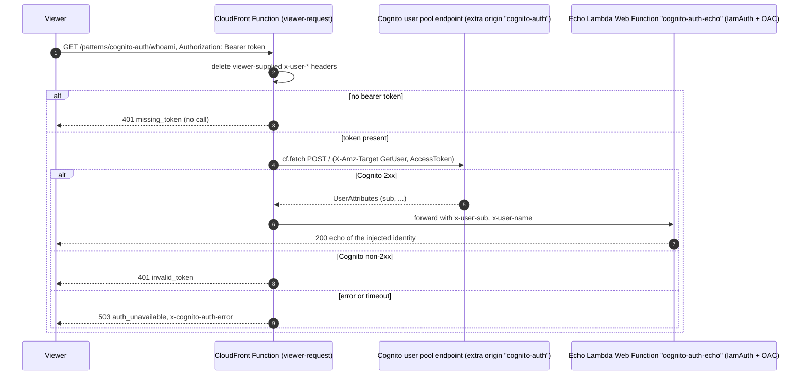

# 01 · cognito-auth

Validate a Cognito access token with one call and forward the request with `x-user-sub`, or deny it at the edge.

Tags: `ai-gateway` `auth` · Hooks: viewer-request · Path: `/patterns/cognito-auth/*`

## What it does

The function sends the viewer's bearer token to Cognito's `GetUser` API with one `cf.fetch` and forwards the request with
`x-user-sub` and `x-user-name`, replacing an API Gateway Lambda authorizer. Cognito authenticates `GetUser` with the token
itself, so the function needs no credentials, no SigV4 and no JWT library. It **fails closed**: no verified identity, no
request to the origin.

## Architecture





## Sequence diagram



## The function

Key points:

- Viewer-supplied `x-user-*` headers are deleted first; no bearer token means a 401 with no call.
- `GetUser` is authenticated by the access token in the body, so there is nothing to sign.
- On success it reads the `sub` attribute and sets `x-user-sub` and `x-user-name`.

The viewer-request function: [`function.js`](function.js).

## Prerequisites

Node.js 22+, AWS credentials for the target account, Docker or npm for Lambda bundling, and a CDK-bootstrapped
`us-east-1` (`npx cdk bootstrap aws://<account-id>/us-east-1`). Run `npm ci` once at the repository root.

## Deploy this pattern

```sh
npx cdk deploy -c patterns=cognito-auth
```

This deploys the one stack with only this pattern's backend and cache behaviors. The `DistributionDomain` output is the
`<distribution domain>` used below. To deploy it next to others, list them: `-c patterns=cognito-auth,authorizer-headers`.

There is no step after deploy. The deploy creates `demo-user` and sets its password from Secrets Manager. The stack also
outputs `UserPoolId`, `ClientId` and `DemoUserPasswordSecret` for signing in with the CLI.

## Try it

The quick way: the demo token route signs `demo-user` in for you and answers a real access token. The password stays in
Secrets Manager; the route's Web Function reads it and calls Cognito `InitiateAuth` itself.

```sh
export DOMAIN=<distribution domain>
export TOKEN=$(curl -s "https://$DOMAIN/patterns/cognito-auth/token" | jq -r .access_token)

curl -si "https://$DOMAIN/patterns/cognito-auth/whoami"                                   # 1. no token
curl -si "https://$DOMAIN/patterns/cognito-auth/whoami" -H "Authorization: Bearer $TOKEN" # 2. valid token
curl -si "https://$DOMAIN/patterns/cognito-auth/whoami" -H "Authorization: Bearer $TOKEN" \
  -H "x-user-sub: forged"                                                                 # 3. forged identity
curl -si "https://$DOMAIN/patterns/cognito-auth/whoami" -H "Authorization: Bearer nope"   # 4. garbage token
```

| Step | Expected |
|---|---|
| 1 | 401 `{"error":"missing_token"}`, `www-authenticate: Bearer`, no call |
| 2 | 200 `{"identity":{"x-user-sub":"<uuid>","x-user-name":"demo-user"}, ...}` |
| 3 | same as 2: `x-user-sub` is the real one, never `forged` |
| 4 | 401 `{"error":"invalid_token"}` (Cognito answered 400 `NotAuthorizedException`) |

Or sign in yourself with the CLI, the way a real client would, then run the same four calls. The outputs are on
`FoundationStack` (`UserPoolId`, `ClientId`, `DemoUserPasswordSecret`; CDK suffixes the output keys). The auth parameters go
in as JSON (built with `jq`), because the generated password can contain `[`, `]` and `,`, which break the CLI's
`USERNAME=...,PASSWORD=...` shorthand.

```sh
export CLIENT_ID=<ClientId output>
export PASSWORD=$(aws secretsmanager get-secret-value --secret-id <DemoUserPasswordSecret output> \
  --query SecretString --output text)
export TOKEN=$(aws cognito-idp initiate-auth --auth-flow USER_PASSWORD_AUTH --client-id "$CLIENT_ID" \
  --auth-parameters "$(jq -cn --arg p "$PASSWORD" '{USERNAME:"demo-user",PASSWORD:$p}')" \
  --query AuthenticationResult.AccessToken --output text)
```

### The demo token route

`GET /patterns/cognito-auth/token` exists for the demo only. It is not part of the pattern, and you would not ship it:

- **Its own cache behavior, no function.** CloudFront matches `/patterns/cognito-auth/token` before
  `/patterns/cognito-auth/*`, so the function never runs on it. Its origin is a second Lambda Web Function, IamAuth + OAC like the echo.
- **One shared token.** Every caller gets the same token, kept in memory until 10 minutes before it expires (tokens live
  60 minutes): about one `InitiateAuth` an hour. An AWS WAF rate rule blocks an IP after about 10 requests a minute. The limit is approximate: AWS WAF evaluates rates
  over a window and acts with a short delay, so in our test about 17 requests got through in about 70 s before the block.
- **Why not a public password.** Anyone holding the password could `ChangePassword` and lock everyone out. A token alone
  cannot change the password. It can `DeleteUser`, so the route creates `demo-user` again when it is gone, and
  `GlobalSignOut`, so the route checks the shared token with `GetUser` at most once a minute and signs in again.

## How it fails

| What goes wrong | The viewer gets | Header |
|---|---|---|
| No bearer token | 401 `missing_token`, no call | `www-authenticate: Bearer` |
| Cognito rejects the token (non-2xx) | 401 `invalid_token` | `www-authenticate: Bearer` |
| Cognito answers without a `sub` | 401 `invalid_token` | `www-authenticate: Bearer` |
| `TypeError`, `TimeoutError` (over 1 s), `InternalError`, a body that is not JSON | 503 `auth_unavailable` | `x-cognito-auth-error` |

## Cost

You pay for what a request uses: one CloudFront request, one CloudFront Functions invocation, one network call to Cognito
`GetUser`, and one Lambda Web Function request for the forwarded request. A request without a token, or with a token Cognito
rejects, stops at the function and never reaches Lambda. Cognito bills by monthly active users, not by `GetUser` call; here that is
the one demo user. A demo token request adds one Web Function request and, about once an hour, one Secrets Manager read and one `InitiateAuth`.

These bill when there is no traffic:

- Two Secrets Manager secrets (the demo user's password and the origin secret), billed per secret per month.
- The distribution's AWS WAF web ACL and the token route's rate rule, billed per month plus per request inspected. The web
  ACL exists because this pattern adds a rule; it is shared with any other pattern that adds one.

See [CloudFront pricing](https://aws.amazon.com/cloudfront/pricing/),
[Lambda pricing](https://aws.amazon.com/lambda/pricing/),
[Amazon Cognito pricing](https://aws.amazon.com/cognito/pricing/),
[Secrets Manager pricing](https://aws.amazon.com/secrets-manager/pricing/) and
[AWS WAF pricing](https://aws.amazon.com/waf/pricing/).

## Security

- **Auth is decided before the origin.** A missing or bad token never leaves CloudFront; the origin only sees requests that
  already carry a verified `x-user-sub`.
- **Viewer identity headers are stripped.** The function deletes every viewer header that starts with `x-user-` before
  anything else, so a forged `x-user-sub` never reaches the origin.
- **The echo origin is locked twice.** It is a Lambda Web Function with an `IamAuth` endpoint behind origin access control
  (OAC, origin type `lambda`, signing `always-amz-auth`), and its resource policy lets only this distribution invoke the
  endpoint: a direct request to the endpoint domain gets 403. CloudFront also adds a secret `x-origin-verify` header, and
  the server refuses requests without it. The demo token route has the same two locks.
- **The Cognito origin needs no lock.** It is the public regional Cognito endpoint. `GetUser` is authenticated by the
  access token in the body, so the function holds no credentials.
- **Fail closed.** When Cognito cannot be asked (error, timeout over 1 s, a body that is not JSON) the function answers
  503 and forwards nothing. An outage blocks traffic instead of letting unauthenticated requests through.
- **The demo password stays in Secrets Manager.** Only the secret's ARN goes into the template and the Lambda
  environment; the custom-resource Lambda and the token route's Web Function read the value at run time. AWS WAF limits the token route
  to about 10 requests per minute per IP (approximate, see above).
- **The shared origin secret is a second lock, and it is visible.** CDK unwraps it at deploy time, so its value is in the
  CloudFormation template, the origin's environment and the distribution's custom-header configuration. The origin is
  already locked by IAM auth and origin access control. For production, pass only the secret's ARN to the origin and
  read the value at run time with a scoped read grant, and rotate the secret together with the CloudFront header.

## Limits and notes

- **An AWS service without SigV4.** `GetUser` is authenticated by the access token, so Cognito is a plain HTTPS custom origin
  (added with `extraOrigins`, no cache behavior) that only `cf.fetch` talks to.
- **Why `GetUser`, not `/oauth2/userInfo`.** No hosted-UI domain to create, the same host for every pool in the Region, and
  the full attribute list in the answer. It counts against the Cognito `GetUser` quota, so a high-traffic API would cache
  verdicts in KVS (see [07](../07-kvs-config-plus-fetch/)).
- **The origins are Fastify servers on Lambda Web Functions.** Lambda routes each HTTPS request to the server on port 3000;
  see [Lambda Web Functions](https://docs.aws.amazon.com/lambda/latest/dg/web-functions.html).
- **AI angle.** A bearer-token gate in front of an MCP server or a model API: no token, no call to the model endpoint. The
  decision is made on the header alone; the function never sees prompts or tool arguments.

Files:

- `pattern.ts`: user pool, public app client, demo user (password in Secrets Manager, set from it at deploy time by a small
  custom-resource Lambda), the echo Web Function with OAC, the Cognito extra origin, the demo token route and its WAF rate rule
- `function.js`: the CloudFront Function
- `lambda/app.mjs`: the echo origin, a Fastify app (checks the secret `x-origin-verify` header, echoes `x-user-*`)
- `lambda/index.js`: starts the echo app on the Web Function's port
- `token/app.mjs`, `token/index.js`: the demo token route, the same way (same header check, signs `demo-user` in, shares
  the token)
- `test/function.test.mjs`: the CloudFront Function
- `test/origin.test.mjs`, `test/token.test.mjs`: the two origins, with `app.inject`; run them all with
  `node --test 'patterns/01-cognito-auth/test/*.test.mjs'`
- `architecture.png`: drawn from the Mermaid block under Architecture by `npm run diagrams`

## Clean up

```sh
npx cdk destroy
```

This deletes the stack: the distribution and its web ACL, the KVS, the default-behavior bucket, and this pattern's user pool (with
`demo-user` and the app client), both secrets, the echo and token Web Functions, and the custom-resource Lambda functions.

The two Web Functions' log groups belong to the stack and are deleted with it. Log groups the stack did not create outlive
it: the `<log group>.local` group the Web Function service adds next to each, each custom-resource Lambda's `/aws/lambda/<function>`, created on first use, and the CloudFront Functions logs
`/aws/cloudfront/function/<function>` in `us-east-1`. Delete them by hand if you do not want to keep the logs.
