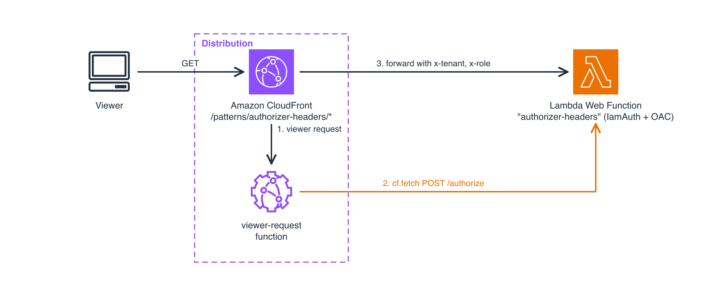
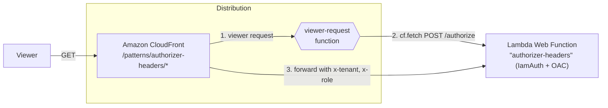
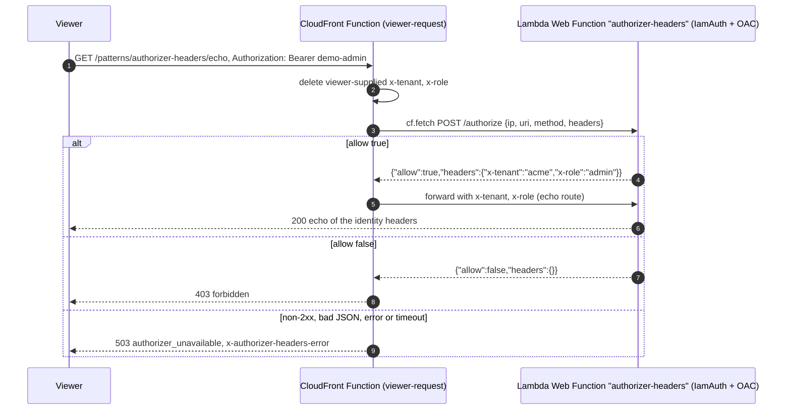

# 02 · authorizer-headers

POST the viewer context to an authorizer, then forward with the identity headers it grants, or answer 403.

Tags: `ai-gateway` `auth` · Hooks: viewer-request · Path: `/patterns/authorizer-headers/*`

## What it does

The API Gateway "Lambda authorizer with context" pattern, moved to the edge. The function POSTs the viewer context to an
authorizer with one `cf.fetch`, gets back `{ allow, headers }`, and either copies the allowlisted identity headers onto the
request or answers 403 itself. The origin only ever sees identity values the authorizer granted. It **fails closed**: an
authorizer that cannot be asked denies.

## Architecture





## Sequence diagram



One Fastify app serves both routes: `POST /authorize` is the authorizer, every other path is the echo. Viewer requests always
arrive under `/patterns/authorizer-headers/...`, so a viewer cannot reach `/authorize` through CloudFront.

## The function

Key points:

- Viewer-supplied `x-tenant` and `x-role` are deleted first. The body is a few hundred bytes, far under the 10 KB cap.
- The POST carries only `content-type`. The OAC signs it with an unsigned payload, so there is no body hash to compute.
- Only exactly `allow: true` passes. The returned headers are lowercased and filtered against `IDENTITY_HEADERS`, so a buggy
  authorizer cannot overwrite `host` or `authorization`.

The viewer-request function: [`function.js`](function.js).

## Prerequisites

Node.js 22+, AWS credentials for the target account, Docker or npm for Lambda bundling, and a CDK-bootstrapped
`us-east-1` (`npx cdk bootstrap aws://<account-id>/us-east-1`). Run `npm ci` once at the repository root.

## Deploy this pattern

```sh
npx cdk deploy -c patterns=authorizer-headers
```

This deploys the one stack with only this pattern's backend and cache behavior. The `DistributionDomain` output is the
`<distribution domain>` used below. To deploy it next to others, list them: `-c patterns=authorizer-headers,cognito-auth`.

There is no step after deploy: the three demo tokens are in the origin code.

## Try it

```sh
export DOMAIN=<distribution domain>
curl -si "https://$DOMAIN/patterns/authorizer-headers/echo"                                      # 1. no token
curl -si "https://$DOMAIN/patterns/authorizer-headers/echo" -H "Authorization: Bearer nope"        # 2. wrong token
curl -si "https://$DOMAIN/patterns/authorizer-headers/echo" -H "Authorization: Bearer demo-admin"  # 3. demo-admin
curl -si "https://$DOMAIN/patterns/authorizer-headers/echo" -H "Authorization: Bearer demo-viewer" # 4. demo-viewer
curl -si "https://$DOMAIN/patterns/authorizer-headers/echo" -H "Authorization: Bearer demo-globex" # 5. demo-globex
curl -si "https://$DOMAIN/patterns/authorizer-headers/echo" -H "Authorization: Bearer demo-viewer" \
  -H "x-tenant: globex" -H "x-role: admin"                                                       # 6. forged headers
```

| Step | Expected |
|---|---|
| 1, 2 | 403 `{"error":"forbidden"}` |
| 3 | 200 `{"path":"/patterns/authorizer-headers/echo","identity":{"x-tenant":"acme","x-role":"admin"}, ...}` |
| 4 | 200, `identity` is `{"x-tenant":"acme","x-role":"viewer"}` |
| 5 | 200, `identity` is `{"x-tenant":"globex","x-role":"admin"}` |
| 6 | same as 4: `acme` and `viewer`, never the forged `globex` or `admin` |

The demo policy in [`lambda/app.mjs`](lambda/app.mjs) knows three tokens:

| Token | `x-tenant` | `x-role` |
|---|---|---|
| `demo-admin` | `acme` | `admin` |
| `demo-viewer` | `acme` | `viewer` |
| `demo-globex` | `globex` | `admin` |

## How it fails

| What goes wrong | The viewer gets | Header |
|---|---|---|
| The authorizer says anything but `allow: true` | 403 `forbidden` | — |
| The authorizer answers non-2xx | 503 `authorizer_unavailable` | `x-authorizer-headers-error: authorizer returned <status>` |
| `TypeError`, `TimeoutError` (over 1 s), `InternalError`, a body that is not JSON | 503 `authorizer_unavailable` | `x-authorizer-headers-error: <name>: <message>` |

`authorizer returned 403` means the call reached the Web Function endpoint but failed its lock: the OAC signature (the
resource policy allows only this distribution) or the `x-origin-verify` custom header.

## Cost

You pay for what a request uses: one CloudFront request, one CloudFront Functions invocation, one network call, and one
Lambda invocation for the call. An allowed request adds one more Lambda invocation for the forwarded request; a denied
one stops at the function. The origin secret is one Secrets Manager secret, billed per month whether or not there is
traffic. Nothing else runs when there is no traffic. See [CloudFront pricing](https://aws.amazon.com/cloudfront/pricing/),
[Lambda pricing](https://aws.amazon.com/lambda/pricing/) and
[Secrets Manager pricing](https://aws.amazon.com/secrets-manager/pricing/).

## Security

- **The origin is locked twice.** It is a Lambda Web Function with an `IamAuth` endpoint behind origin access control
  (OAC, origin type `lambda`, signing `always-amz-auth`): CloudFront signs every origin request, the network call included,
  and the function's resource policy lets only this distribution invoke the endpoint. A direct request to the endpoint
  domain gets 403. CloudFront also adds a secret `x-origin-verify` header on every origin request, and the app refuses
  requests without it.
- **`/authorize` is not reachable by viewers.** Viewer requests always arrive under `/patterns/authorizer-headers/...`, so
  only the function's call hits `POST /authorize`.
- **Viewer identity headers are stripped.** The function deletes viewer-supplied `x-tenant` and `x-role` before the call,
  so a forged value never reaches the origin.
- **Allowlists both ways.** Only `authorization` and `user-agent` go to the authorizer; only `x-tenant` and `x-role` come
  back, lowercased. A buggy authorizer cannot overwrite `host` or `authorization`.
- **Fail closed.** Only exactly `allow: true` passes. A non-2xx answer, an error, a timeout over 1 s or a body that is not
  JSON gives 503: an authorizer that cannot be asked never lets a request through.
- **The shared origin secret is a second lock, and it is visible.** CDK unwraps it at deploy time, so its value is in the
  CloudFormation template, the origin's environment and the distribution's custom-header configuration. The origin is
  already locked by IAM auth and origin access control. For production, pass only the secret's ARN to the origin and
  read the value at run time with a scoped read grant, and rotate the secret together with the CloudFront header.

## Limits and notes

- **The decision and the identity travel together.** One POST, one JSON answer carrying both `allow` and the headers.
- **The origin is a Fastify server on a [Lambda Web Function](https://docs.aws.amazon.com/lambda/latest/dg/web-functions.html).**
  `lambda/app.mjs` builds the app, `lambda/index.js` starts it on port 3000.
- **A cold origin fails closed once.** The authorizer is a Lambda Web Function, and its first request after idle can take
  over the fixed 1 s, so that request fails closed: in our test the first call after a deploy got 503
  `authorizer_unavailable` with `x-authorizer-headers-error: TimeoutError: "cloudfront.fetch": Request timed out` after
  1.37 s. Later requests are warm (0.67 s, the expected 403), so run step 1 again.
- **AI angle.** An AI gateway authorizer: map an identity to a model tier, the allowed models and a quota class, returned as
  headers the LLM proxy can trust because the viewer's copies are stripped first. The decision is per identity, not per prompt.

Files:

- `pattern.ts`: the secret and the authorizer Web Function with its IamAuth endpoint behind OAC
- `function.js`: the CloudFront Function
- `lambda/app.mjs`: the Fastify app, `POST /authorize` (the demo policy: the three tokens above) and the echo
- `lambda/index.js`: the Web Function entry point, starts the app on port 3000
- `test/function.test.mjs`, `test/origin.test.mjs`: unit tests, `node --test 'patterns/02-authorizer-headers/test/*.test.mjs'`
- `architecture.png`: drawn from the Mermaid block under Architecture by `npm run diagrams`

## Clean up

```sh
npx cdk destroy
```

This deletes the stack: the distribution, the KVS, the default-behavior bucket, and this pattern's Lambda Web Function and secret.

The Web Function's log group belongs to the stack and is deleted with it. Log groups the stack did not create outlive it:
the `<log group>.local` group the Web Function service adds next to it,
a plain Lambda function's `/aws/lambda/<function>`, created on first use, and the CloudFront Functions logs
`/aws/cloudfront/function/<function>` in `us-east-1`. Delete them by hand if you do not want to keep the logs.
