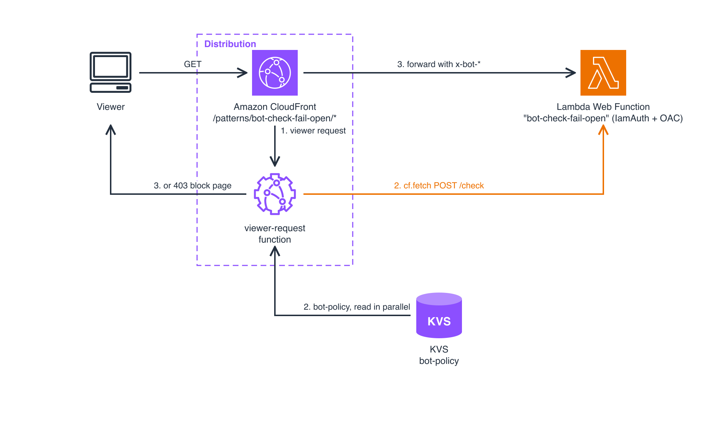
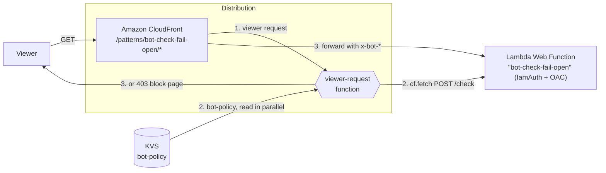
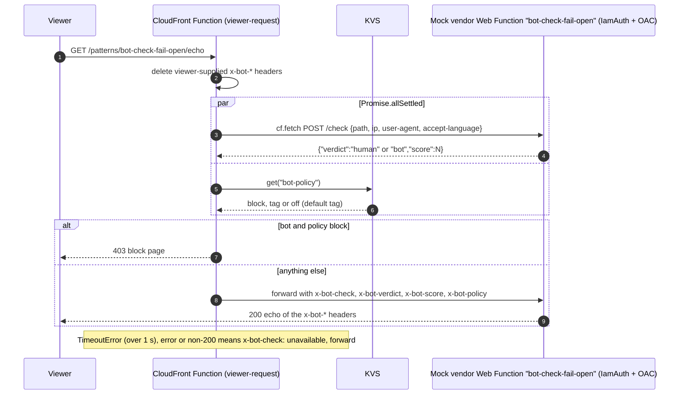

# 03 · bot-check-fail-open

Ask a bot-detection vendor, read the policy from KVS in parallel, and fail open when the vendor is slow or down.

Tags: `ai-gateway` `agents` · Hooks: viewer-request · Path: `/patterns/bot-check-fail-open/*`

## What it does

The function asks a bot-detection vendor about every request and reads a `block | tag | off` policy from KVS at the same
time. A bot verdict with policy `block` gets a 403 page; with `tag` the request is forwarded with the verdict in headers. If
the vendor takes over the runtime's fixed 1 s or is down, the request goes through anyway: a third-party check **fails
open**. The vendor is a mock on a Lambda Web Function, so the pattern runs without a contract.

## Architecture





## Sequence diagram



## The function

Key points:

- `Promise.allSettled`, not `Promise.all`: one `cf.fetch` and one KVS read run in parallel, and a missing `bot-policy` key
  must not lose the verdict.
- There is no `timeout` option: the runtime's fixed 1 s `TimeoutError` is the only latency limit, and it fails open. The
  function does not time the call itself, because `Date.now()` does not advance across an awaited `cf.fetch`, so a tighter
  self-timed budget would never fire.
- Viewer-supplied `x-bot-*` headers are deleted first.

The viewer-request function: [`function.js`](function.js).

## Prerequisites

Node.js 22+, AWS credentials for the target account, Docker or npm for Lambda bundling, and a CDK-bootstrapped
`us-east-1` (`npx cdk bootstrap aws://<account-id>/us-east-1`). Run `npm ci` once at the repository root.

## Deploy this pattern

```sh
npx cdk deploy -c patterns=bot-check-fail-open
```

This deploys the one stack with only this pattern's backend and cache behavior. The `DistributionDomain` output is the
`<domain>` used below. To deploy it next to others, list them: `-c patterns=bot-check-fail-open,hello-fetch`.

The policy needs no setup: with no `bot-policy` key the function uses `tag`. Every deploy creates a new, empty KVS, so a
policy you set is gone after the next deploy. To set it (step 5 below), take the store's ARN from the `KeyValueStoreArn`
output:

```sh
KVS_ARN=$(aws cloudformation describe-stacks --stack-name FoundationStack \
  --query "Stacks[0].Outputs[?OutputKey=='KeyValueStoreArn'].OutputValue" --output text)
```

## Try it

```sh
P=https://<domain>/patterns/bot-check-fail-open/echo
curl -s "$P" -H 'accept-language: en'          # 1. human
curl -s "$P" -A 'Googlebot/2.1'                # 2. bot, policy tag: forwarded but tagged
curl -s "$P" -H 'x-force-verdict: bot'         # 3. force a verdict
curl -s "$P" -H 'x-mock-delay-ms: 1500'        # 4. vendor slower than the 1 s runtime timeout
curl -si "$P" -H 'x-force-verdict: bot'        # 5. after setting bot-policy=block: 403
```

| Step | Expected |
|---|---|
| 1 | `x-bot-check: ok`, `x-bot-verdict: human`, `x-bot-policy: tag` |
| 2, 3 | `x-bot-verdict: bot`, `x-bot-score: 100` (2: 60 for the user-agent plus 40 for no `accept-language`), still forwarded |
| 4 | after about 1 s: `x-bot-check: unavailable`, no verdict, `x-bot-check-fail-open-error: TimeoutError: "cloudfront.fetch": Request timed out` |
| 5 | HTTP 403 and the block page |

The mock scores `x-force-verdict` as 100 or 0, adds 60 for an empty or bot-like `user-agent` and 40 for a missing
`accept-language`; 50 or more is a bot. `x-mock-delay-ms: N` (max 5000) makes it sleep. Set the policy:

```sh
aws cloudfront-keyvaluestore put-key --kvs-arn "$KVS_ARN" --key bot-policy --value block \
  --if-match "$(aws cloudfront-keyvaluestore describe-key-value-store --kvs-arn "$KVS_ARN" --query ETag --output text)"
```

## How it fails

| What goes wrong | The viewer gets | Header |
|---|---|---|
| The vendor answers non-2xx | forwarded, no verdict | `x-bot-check-fail-open-error: Error: vendor returned <status>` |
| `TimeoutError`: the vendor took over 1 s | forwarded, no verdict | `x-bot-check: unavailable`, `x-bot-check-fail-open-error: TimeoutError: ...` |
| `TypeError`, `InternalError`, an unreadable verdict | forwarded, no verdict | `x-bot-check-fail-open-error` |
| No KVS, no `bot-policy` key, or an unknown value | policy `tag` | `x-bot-policy-source: default: <name>: <message>` |

## Cost

You pay for what a request uses: one CloudFront request, one CloudFront Functions invocation, one KVS read, one network
call, and one Lambda Web Function request for `POST /check`. A forwarded request adds one Web Function request for the
echo; a blocked request does not reach the origin. A slow vendor bills Lambda duration even after the function has given
up at 1 s: with `x-mock-delay-ms` the mock sleeps up to 5 s. The secret is one Secrets Manager secret, billed per month. Nothing runs
when there is no traffic. See [CloudFront pricing](https://aws.amazon.com/cloudfront/pricing/) (Functions and KVS),
[Lambda pricing](https://aws.amazon.com/lambda/pricing/) and
[Secrets Manager pricing](https://aws.amazon.com/secrets-manager/pricing/).

## Security

- The mock vendor is a Lambda Web Function with an `IamAuth` endpoint behind origin access control (OAC, origin type
  `lambda`, signing `always-amz-auth`). CloudFront signs every origin request, the network call included. The function's
  resource policy lets only the CloudFront service principal for this distribution invoke the endpoint; a direct request
  to the endpoint domain is refused with 403.
- CloudFront adds a secret `x-origin-verify` header on every origin request, the network call included; the mock refuses
  any request without it with 403. The secret value is resolved into the Lambda environment and the distribution's origin
  settings, so anyone who can read those can read it.
- The function deletes every viewer-supplied `x-bot-*` header before it does anything, so a viewer cannot forge a verdict
  or a policy for the origin.
- `x-force-verdict` and `x-mock-delay-ms` are demo knobs: the function passes them to the mock as-is. A real vendor
  integration must not let the viewer steer the check.
- **Fail open.** A slow or broken vendor forwards the request with `x-bot-check: unavailable`. The bot check is a signal,
  not an authorization decision, so an outage at the vendor must not take the site down. The origin can read
  `x-bot-check` and decide for itself. Compare [01](../01-cognito-auth/) and [02](../02-authorizer-headers/), where the
  call is the authorization decision and fails closed.
- **The shared origin secret is a second lock, and it is visible.** CDK unwraps it at deploy time, so its value is in the
  CloudFormation template, the origin's environment and the distribution's custom-header configuration. The origin is
  already locked by IAM auth and origin access control. For production, pass only the secret's ARN to the origin and
  read the value at run time with a scoped read grant, and rotate the secret together with the CloudFront header.

## Limits and notes

- **The 1 s timeout is the budget.** A slow vendor costs the viewer up to 1 s before the request is forwarded. There is no
  tighter limit to set: no `timeout` option exists, and timing the call with `Date.now()` does not work at the edge (the
  clock does not move across the await). Pick a vendor endpoint that answers well inside 1 s.
- **Policy in KVS.** `tag` to `block` is a KVS write, not a redeploy. `x-bot-policy-source` says whether it came from KVS or
  a default.
- **The origin is a Fastify server on a Lambda Web Function**
  ([Lambda Web Functions](https://docs.aws.amazon.com/lambda/latest/dg/web-functions.html)): `lambda/app.mjs` builds the
  app, `lambda/index.js` listens on the port Lambda routes requests to.
- **A cold mock vendor fails open once.** The vendor mock is a Lambda Web Function, and its first request after idle can
  take over the fixed 1 s, so that request fails open: in our test the first call after a deploy took 1.81 s and was
  forwarded with `x-bot-check: unavailable` and `TimeoutError: "cloudfront.fetch": Request timed out`. Later requests are
  warm (0.96 s, `x-bot-check: ok`).
- **AI angle.** Classify AI crawlers and agent traffic before an expensive model endpoint. Fail open matters more there: a
  slow classifier must never block a human, and a false block costs a paying user.

Files:

- `pattern.ts`: the mock vendor Web Function with OAC and the secret header, `keyValueStore: true`
- `function.js`: the CloudFront Function
- `lambda/app.mjs`: the mock vendor's Fastify app (`POST /check`) and the echo
- `lambda/index.js`: the Web Function entry point, starts the app
- `test/function.test.mjs`, `test/origin.test.mjs`: unit tests, `node --test 'patterns/03-bot-check-fail-open/test/*.test.mjs'`
- `demo.json`: the demo card
- `architecture.png`: drawn from the Mermaid block under Architecture by `npm run diagrams`

## Clean up

```sh
npx cdk destroy
```

This deletes the stack: the distribution, the KVS (and the `bot-policy` key with it), this pattern's mock vendor Web
Function and secret, and the demo bucket.

The Web Function's log group belongs to the stack and is deleted with it. Log groups the stack did not create outlive it:
the `<log group>.local` group the Web Function service adds next to it,
a plain Lambda function's `/aws/lambda/<function>`, created on first use, and the CloudFront Functions logs
`/aws/cloudfront/function/<function>` in `us-east-1`. Delete them by hand if you do not want to keep the logs.
