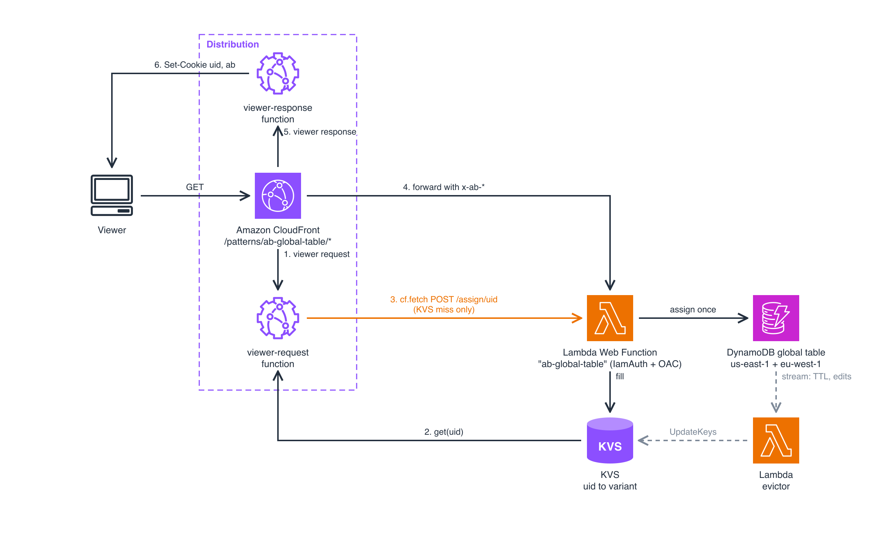
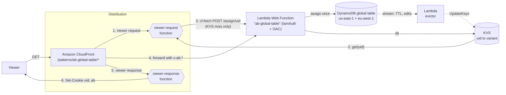
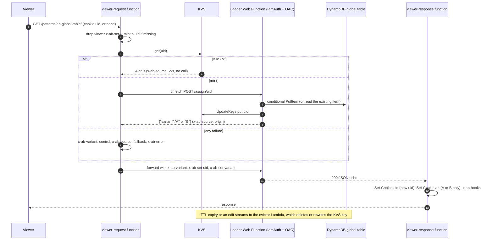

# 04 · ab-global-table

A sticky A/B variant per user from KVS; only a miss calls the origin, which assigns once in a DynamoDB global table.

Tags: `ai-gateway` `routing` · Hooks: viewer-request + viewer-response · Path: `/patterns/ab-global-table/*`

## What it does

The viewer-request function reads the user's variant from KVS and calls the origin only on a miss; the origin assigns it once
in a DynamoDB global table and fills KVS lazily. A viewer-response function turns the decision into cookies, so stickiness
survives cache hits. It fails open: any failure serves `control`.

## Architecture





## Sequence diagram



## The function

Key points:

- KVS first; only a miss makes the call. A missing key or no associated KVS throws, which counts as a miss.
- The uid is a hash of the request id, viewer IP and time: `Math.random()` before the call would make the call fail.
- The POST needs no body hash: CloudFront signs requests to the Web Function endpoint with an unsigned payload.
- The request side decides and never sets a cookie; the response side validates `x-ab-set-*` again and makes no call.

The viewer-request function: [`function.js`](function.js).

The viewer-response function: [`response-function.js`](response-function.js).

## Prerequisites

Node.js 22+, AWS credentials for the target account, Docker or npm for Lambda bundling, and a CDK-bootstrapped
`us-east-1` (`npx cdk bootstrap aws://<account-id>/us-east-1`). Run `npm ci` once at the repository root.

## Deploy this pattern

```sh
npx cdk deploy -c patterns=ab-global-table
```

This deploys the one stack with only this pattern's backend and cache behavior. The `DistributionDomain` output is the
`<domain>` used below. To deploy it next to others, list them: `-c patterns=ab-global-table,hello-fetch`.

No step after deploy: the KVS starts empty and fills on first visits. Every deploy creates a new, empty KVS, so the next
visit of every user is a miss and one call; DynamoDB still holds the assignment and returns the same variant.

## Try it

```sh
# first visit: no cookie, KVS miss
curl -si https://<domain>/patterns/ab-global-table/ | grep -iE 'set-cookie|x-ab-|"variant"'
# return visit with the cookie
curl -si https://<domain>/patterns/ab-global-table/ -H 'Cookie: uid=0123456789abcdef' | grep -iE 'set-cookie|x-ab-'
```

Whatever the variant, the response carries `x-ab-hooks: request+response`. Every `A` or `B` response sets
`Set-Cookie: ab=A` or `ab=B`, not only the first; a first visit also gets
`Set-Cookie: uid=<16 hex>; Path=/patterns/ab-global-table/; Max-Age=86400; Secure; HttpOnly; SameSite=Lax`.
`x-ab-hooks` is the only `x-ab-*` response header: the grep finds `x-ab-source`, `x-ab-kvs` and `x-ab-variant` in the
echo's JSON body, as the request headers the function sent to the origin.

| Visit | `x-ab-source` | `x-ab-kvs` | What happened |
|---|---|---|---|
| first | `origin` | `miss: ...` | one `cf.fetch`, DynamoDB item created, KVS filled, `Set-Cookie: ab=A` or `B` |
| return, within about a minute | `origin` | `miss: KeyNotFound` | the KVS write has not reached the edge yet, so one more call; harmless, DynamoDB returns the same variant |
| return, about a minute later | `kvs` | `hit` | no call |
| after 24 h | `origin` | `miss: ...` | TTL deleted the item, the stream evicted the key, one call again |

A KVS write takes about 30-60 s to reach the edge (measured 2026-10-27), so the first hit comes about a minute after the
first visit, not seconds.

Check the DynamoDB side directly:

```sh
TABLE=$(aws cloudformation list-stack-resources --stack-name FoundationStack \
  --query "StackResourceSummaries[?ResourceType=='AWS::DynamoDB::GlobalTable'].PhysicalResourceId" --output text)
aws dynamodb scan --table-name "$TABLE" --region eu-west-1   # the replica sees the item
```

## How it fails

| What goes wrong | The viewer gets | Header |
|---|---|---|
| `TypeError`, `TimeoutError` (over 1 s), `InternalError`, a bad answer | forwarded as `control`, no `ab` cookie | `x-ab-variant: control`, `x-ab-source: fallback`, `x-ab-error` |
| The loader answers 403 | as above | `x-ab-error` names the status: OAC or the secret header is not reaching the loader |
| No KVS associated | counts as a miss, one call | `x-ab-kvs: miss: <reason>` |
| The response function is not attached | no cookies | no `x-ab-hooks` |

`control` is not an assignment, so it never becomes a cookie.

## Cost

On a KVS hit, a request uses one CloudFront request, two CloudFront Functions invocations (viewer-request and
viewer-response), one KVS read and one request to the loader Web Function for the forwarded request. A miss adds one network call and one
more loader request, which does a DynamoDB conditional write, replicated to eu-west-1 (or a read when the user already has
a variant), and two KVS API calls (`DescribeKeyValueStore` for the ETag, then `UpdateKeys`). DynamoDB stream records,
TTL deletes included, invoke the evictor in batches of up to 100.

When idle: the table is on-demand, so there is no provisioned capacity, but its storage bills in both Regions. The
secret is one Secrets Manager secret, billed per month. See
[CloudFront pricing](https://aws.amazon.com/cloudfront/pricing/) (Functions and KVS),
[Lambda pricing](https://aws.amazon.com/lambda/pricing/),
[DynamoDB on-demand pricing](https://aws.amazon.com/dynamodb/pricing/on-demand/) (global tables and streams) and
[Secrets Manager pricing](https://aws.amazon.com/secrets-manager/pricing/).

## Security

- The loader is a Lambda Web Function with an `IamAuth` endpoint behind origin access control (OAC, origin type `lambda`,
  signing `always-amz-auth`). Its resource policy lets `cloudfront.amazonaws.com` invoke the endpoint for this
  distribution only; a direct request to the endpoint domain is refused with 403.
- CloudFront adds a secret `x-origin-verify` header on every origin request, the network call included; the loader
  refuses any request without it with 403. Its echo shows the header as `<present>`, never its value. The secret value is
  resolved into the Web Function environment and the distribution's origin settings, so anyone who can read those can read it.
- The viewer-request function deletes viewer-supplied `x-ab-set-uid` and `x-ab-set-variant`, the two headers the
  viewer-response function turns into cookies, and overwrites `x-ab-uid`, `x-ab-kvs`, `x-ab-variant` and `x-ab-source`.
  The response side checks both values again: a uid must be 16 hex characters, a variant `A` or `B`.
- The uid is a bucket key, not an identity. A viewer can send any well-formed `uid` cookie and get that uid's variant;
  the loader accepts only 16 lowercase hex characters.
- The loader's role may read and write items in its own table. On the shared KVS, only the evictor may
  call `DescribeKeyValueStore` and `UpdateKeys`.
- The cookies are `Secure; HttpOnly; SameSite=Lax` and scoped to `/patterns/ab-global-table/`.
- **Fail open.** Any failure serves `control` and sets no `ab` cookie. A variant is not an access decision, so an
  outage must not block the page; the next visit tries again.
- **The shared origin secret is a second lock, and it is visible.** CDK unwraps it at deploy time, so its value is in the
  CloudFormation template, the origin's environment and the distribution's custom-header configuration. The origin is
  already locked by IAM auth and origin access control. For production, pass only the secret's ARN to the origin and
  read the value at run time with a scoped read grant, and rotate the secret together with the CloudFront header.

## Limits and notes

- **Fetch only on a miss.** A value that changes once a day should not cost a network call per request: one user, one call
  per TTL (24 h here), KVS for everything else.
- **Two executions, one call each.** The request side spends its one call deciding; the response side runs on every
  response including cache hits, so it makes none. An origin-set cookie would vanish on a cache hit.
- **DynamoDB is the truth, not the hash.** `hash(uid) % 2` makes the first assignment coordination-free, but overrides,
  re-bucketing and audit need the table. The eu-west-1 replica lets a second regional loader share it; replicated writes
  reach the us-east-1 stream, so one evictor keeps KVS in sync.
- **KVS is a budget, not a database.** 5 MB per store at ~17 bytes per user (16-char uid, 1-char variant) is ~300 000
  active users; the evictor batches up to 100 records per `UpdateKeys`.
- **The 1 s budget is tight for a cold loader.** The origin is a Lambda Web Function, and a first assignment does a
  DynamoDB conditional write before it answers. Its first request after idle can take over the fixed
  1 s, so that request fails open: in our test the first visit after a deploy took 1.72 s and was served as `control`
  with `x-ab-error: TimeoutError: "cloudfront.fetch": Request timed out`. The loader still finished the assignment, and
  the warm retry took 0.94 s and got its variant.
- **The DynamoDB stream fills KVS, not the loader.** The loader only writes the table; the stream consumer (a plain Lambda)
  turns the INSERT into the KVS key, a MODIFY into a rewrite and a REMOVE into an eviction, so there is one KVS writer. A
  KVS write signed from the Web Function itself fails with `AccessDeniedException: Authentication failed` (the KVS data
  plane needs SigV4a). The fill lags the assignment by the stream batch window (up to 5 s) plus KVS propagation.
- **The origin is a Fastify server** on a [Lambda Web Function](https://docs.aws.amazon.com/lambda/latest/dg/web-functions.html);
  the evictor stays a normal Lambda function triggered by the DynamoDB stream.
- **AI angle.** Replace `A` and `B` with model or prompt version ids: assigned once, globally consistent, served from the
  edge, and handed to the proxy in `x-ab-variant`.

Files:

- `pattern.ts`: both functions, the global table (us-east-1 + eu-west-1, TTL, stream), the loader Web Function (IamAuth
  endpoint, OAC, resource policy for this distribution) and the evictor Lambda, the secret
- `function.js`: viewer-request, decides and never sets cookies
- `response-function.js`: viewer-response, sets cookies and never calls anything
- `test/`: function and origin unit tests, `node --test 'patterns/04-ab-global-table/test/*.test.mjs'` (needs `npm ci` in
  `lambda/` first)
- `lambda/app.mjs`: the origin, a Fastify app with `POST /assign/<uid>` and the echo
- `lambda/index.js`: the Web Function entry point, starts the app on port 3000
- `test/origin.test.mjs`: the origin, exercised with `app.inject` and a fake DynamoDB client and KVS writer
- `lambda/stream.mjs`, `lambda/plan.mjs`, `lambda/kvs.mjs`, `lambda/assign.mjs`: evictor, batching, ETag retry, hashing
- `lambda/test/`: assignment and batching unit tests, `cd lambda && npm ci && npm test`. `lambda/package.json` pins
  Fastify, the DynamoDB client, and the KVS client with the SigV4a signer the Lambda runtime SDK lacks
- `demo.json`: the demo card
- `architecture.png`: drawn from the Mermaid block under Architecture by `npm run diagrams`

## Clean up

```sh
npx cdk destroy
```

This deletes the stack: the distribution, the KVS, this pattern's DynamoDB global table with its eu-west-1 replica, the
loader Web Function, the evictor Lambda function, the secret, and the demo bucket.

The Web Function's log group belongs to the stack and is deleted with it. Log groups the stack did not create outlive it:
the `<log group>.local` group the Web Function service adds next to it,
a plain Lambda function's `/aws/lambda/<function>`, created on first use, and the CloudFront Functions logs
`/aws/cloudfront/function/<function>` in `us-east-1`. Delete them by hand if you do not want to keep the logs.
