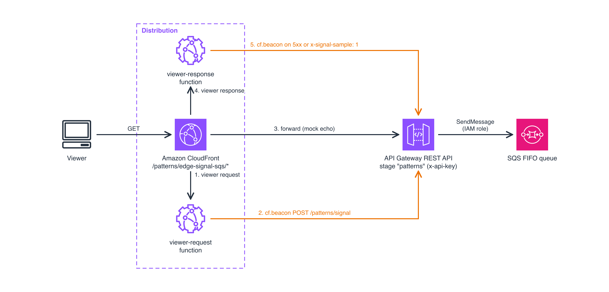
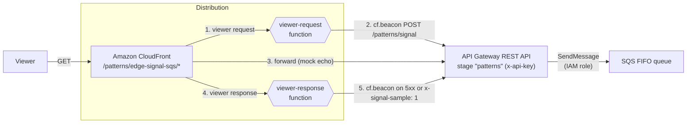
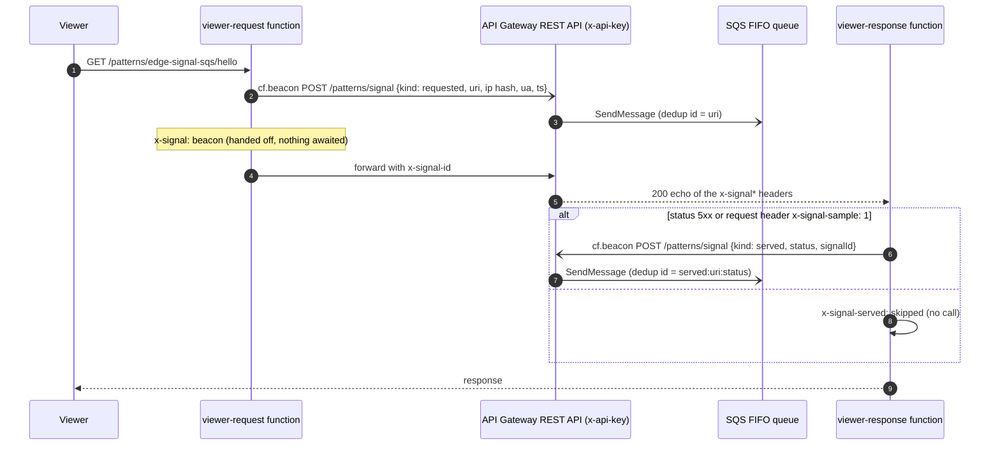

# 05 · edge-signal-sqs

Fire-and-forget an event into SQS FIFO through API Gateway with `cf.beacon`, no Lambda; a second event only on demand.

Tags: `ai-gateway` `telemetry` · Hooks: viewer-request + viewer-response · Path: `/patterns/edge-signal-sqs/*`

## What it does

The request function drops one small JSON event into an SQS FIFO queue through an API Gateway service integration, with
`cf.beacon` (fire-and-forget) and no Lambda anywhere; API Gateway does the SigV4 signing. The response function sends a second
`served` event, but only on a 5xx or on demand, because a response-side call runs on cache hits too. Nothing is awaited, so
the viewer never waits for the queue.

## Architecture





## Sequence diagram



CloudFront does not run viewer-response functions when the origin returns 400 or higher (documented in
[Restrictions on all edge functions](https://docs.aws.amazon.com/AmazonCloudFront/latest/DeveloperGuide/edge-function-restrictions-all.html)),
so the 5xx branch is the rule this pattern teaches, and `x-signal-sample: 1` is what makes the served event observable.

## The function

Key points:

- `cf.beacon` returns `undefined`; there is nothing to await. `logDeliveryErrors: true` is the only way to see a beacon that
  fails after the function returned.
- The raw viewer IP never leaves the edge, only a truncated SHA-256. The URI is the FIFO dedup id, carried to the response
  side in `x-signal-id`.
- The response side beacons only when the status is 500 or more or the request had `x-signal-sample: 1`.

The viewer-request function: [`function.js`](function.js).

The viewer-response function: [`response-function.js`](response-function.js).

## Prerequisites

Node.js 22+, AWS credentials for the target account, Docker or npm for Lambda bundling, and a CDK-bootstrapped
`us-east-1` (`npx cdk bootstrap aws://<account-id>/us-east-1`). Run `npm ci` once at the repository root.

## Deploy this pattern

```sh
npx cdk deploy -c patterns=edge-signal-sqs
```

This deploys the one stack with only this pattern's backend and cache behavior. The `DistributionDomain` output is the
`<domain>` used below, and the `QueueUrl` output is the queue that Try it reads. No step is needed after the deploy. To
deploy it next to others, list them: `-c patterns=edge-signal-sqs,hello-fetch`.

## Try it

```sh
curl -si https://<domain>/patterns/edge-signal-sqs/hello                          # 1. requested event
curl -si -H 'x-signal-sample: 1' https://<domain>/patterns/edge-signal-sqs/hello  # 2. plus a served event
curl -si https://<domain>/patterns/edge-signal-sqs/boom                           # 3. a real 503
```

| Step | Expected |
|---|---|
| 1 | 200 echo: `x-signal: beacon`; response `x-signal-served: skipped` |
| 2 | as 1, plus response `x-signal-served: beacon` |
| 3 | 503 `{"path": "/patterns/edge-signal-sqs/boom", "boom": true}` and **no** `x-signal-served` header: CloudFront skipped the viewer-response function |

Then read the queue (the `QueueUrl` output of `FoundationStack`), and delete what you read:

```sh
QUEUE_URL=$(aws cloudformation describe-stacks --stack-name FoundationStack \
  --query "Stacks[0].Outputs[?contains(OutputKey,'edgesignalsqsQueueUrl')].OutputValue" --output text)
aws sqs receive-message --queue-url "$QUEUE_URL" --max-number-of-messages 10 --wait-time-seconds 5 \
  --query 'Messages[].[Body,ReceiptHandle]' --output text |
while IFS=$'\t' read -r body handle; do
  echo "$body"
  aws sqs delete-message --queue-url "$QUEUE_URL" --receipt-handle "$handle"
done
```

The queue is FIFO with one message group, so a read without the delete returns the oldest 10 messages every time and
never the newer ones. Run the read again until it prints nothing.

You get `{"kind":"requested","uri":"/patterns/edge-signal-sqs/hello","ip":"<16 hex>","ua":"curl/...","ts":...}` and,
after step 2, `{"kind":"served","uri":"/patterns/edge-signal-sqs/hello","status":200,"signalId":"/patterns/edge-signal-sqs/hello","dedupId":"served:/patterns/edge-signal-sqs/hello:200",...}`.
The same URL again within 5 minutes adds nothing: same dedup ids. Step 3 adds a `requested` event for `/boom` too: the
request side runs before the origin answers, so errors are counted as well.

## How it fails

| What goes wrong | The viewer gets | Header |
|---|---|---|
| `cf.beacon` throws (a bad option, a second call) | forwarded | `x-signal: failed`, `x-signal-error` |
| Delivery fails after the function returned | forwarded, `x-signal: beacon` | none; the failure is in CloudWatch Logs (`logDeliveryErrors`) |
| The response-side beacon throws | the response | `x-signal-served: failed`, `x-signal-served-error` |
| The origin answers 4xx or 5xx | the error | none: viewer-response does not run |

`x-signal: beacon` means handed off, not delivered; count messages in the queue.

## Cost

You pay for what a request uses: one CloudFront request, two CloudFront Functions invocations (viewer-request, and
viewer-response on every response below 400), one network call, and two API Gateway REST API requests: the beacon's
`POST /patterns/signal` and the forwarded request, which a mock integration answers with no backend. Each beacon that
arrives is one SQS `SendMessage` request. No Lambda runs.

A `served` event adds one more network call, API Gateway request and SQS message. Response-side calls must be rare by
construction: the gate is a property of the response (a 5xx) or an explicit opt-in, never a random sample, so a healthy
site pays nothing for them.

When there is no traffic, the API key's Secrets Manager secret still bills per month. The REST API, the usage plan and
the queue bill per request. Delivery failures logged with `logDeliveryErrors` bill as CloudWatch Logs ingestion and
storage. See [CloudFront pricing](https://aws.amazon.com/cloudfront/pricing/),
[API Gateway pricing](https://aws.amazon.com/api-gateway/pricing/), [SQS pricing](https://aws.amazon.com/sqs/pricing/),
[Secrets Manager pricing](https://aws.amazon.com/secrets-manager/pricing/) and
[CloudWatch pricing](https://aws.amazon.com/cloudwatch/pricing/).

## Security

- The origin is a public regional REST API endpoint, and every method requires an API key (`apiKeyRequired: true`). A
  REST API (not HTTP API) can require an API key without a Lambda authorizer. CloudFront adds the key as an `x-api-key`
  custom origin header on every origin request, the beacons included. The key is generated into a Secrets Manager secret.
  A request without the key is refused with 403.
- The key is a shared secret, not a signature: anyone who has it can call the API directly.
- The functions hold no AWS credentials. API Gateway signs `SendMessage` with an IAM role that may only send to this
  queue.
- The raw viewer IP never leaves the edge, only a truncated SHA-256. The user-agent is cut to 200 characters.
- The functions strip no viewer headers. The request function sets `x-signal-id` and `x-signal` on every request, and
  `x-signal-error` only on failure. The mock echo reflects every `x-signal*` header it receives, so a viewer can add its
  own. Treat them as debug output, not as facts.
- `x-signal-sample: 1` is a viewer header: any viewer can ask for a `served` event. The FIFO dedup id drops repeats of
  the same URI and status for 5 minutes, but each new URI is a new message.
- It fails open: the request is always forwarded and nothing is awaited. Losing a telemetry event is better than holding
  up the viewer.
- **The API key is visible.** CDK unwraps it at deploy time, so its value is in the CloudFormation template and the
  distribution's custom-header configuration; anyone who can read either can call the API directly. Keep the usage plan
  throttling, restrict who can read the stack and distribution, and rotate the key together with the CloudFront header.

## Limits and notes

- **API Gateway is the signing proxy for SigV4-only services.** There is no SDK and no signing in a CloudFront Function; a
  REST API service integration signs `SendMessage` with an IAM role and a mapping template builds it from the JSON body. The
  same works for DynamoDB, EventBridge, Kinesis, SNS.
- **`cf.beacon` is still the one call.** A function that beacons cannot also fetch.
- **AI angle.** Request telemetry for AI endpoints: path, user-agent, time and, with 01 or 02 in front, the caller. No prompts
  and no token counts; the function cannot read the body.

Files:

- `pattern.ts`: the FIFO queue, the REST API (stage `patterns`, so viewer paths need no rewrite), API key, SQS integration,
  echo and `/boom` mocks
- `function.js`: the viewer-request function
- `response-function.js`: the viewer-response function
- `test.mjs`: unit tests for both functions, `node patterns/05-edge-signal-sqs/test.mjs`
- `architecture.png`: drawn from the Mermaid block under Architecture by `npm run diagrams`

## Clean up

```sh
npx cdk destroy
```

This deletes the stack: the distribution, the KVS, the default-behavior bucket and, for this pattern, both CloudFront Functions, the
FIFO queue and any messages in it, the REST API with its API key and usage plan, the API Gateway role and the API key
secret. CloudWatch log groups that CloudFront creates for function logs are not part of the stack and stay.
