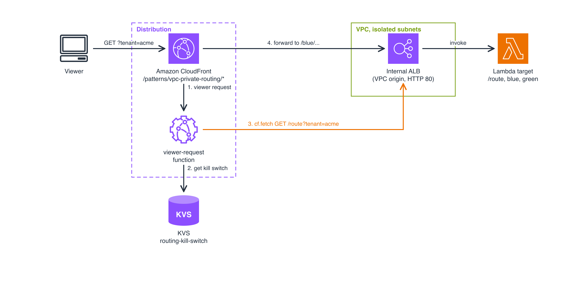
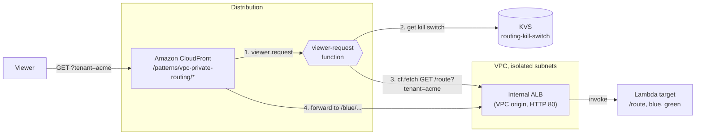
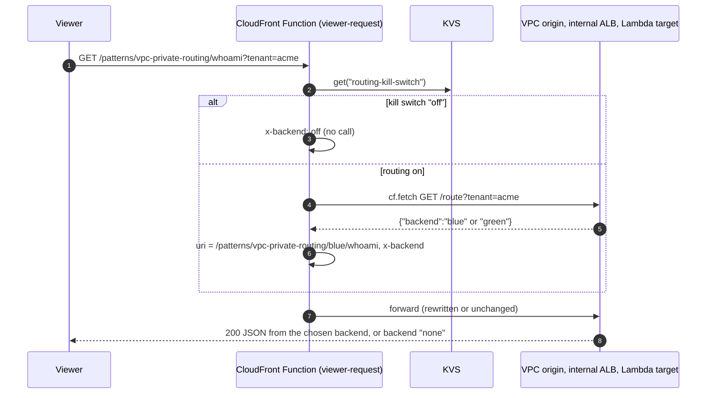

# 06 · vpc-private-routing

Ask an internal ALB behind a VPC origin which backend a tenant belongs to, then rewrite the URI.

Tags: `ai-gateway` `routing` · Hooks: viewer-request · Path: `/patterns/vpc-private-routing/*`

## What it does

The function asks a **private** routing service which backend a tenant belongs to, then rewrites the URI to that backend. The
service is an internal Application Load Balancer with no public address, reached through a CloudFront
[VPC origin](https://docs.aws.amazon.com/AmazonCloudFront/latest/DeveloperGuide/private-content-vpc-origins.html). A KVS kill
switch skips the call entirely. It fails open: any failure forwards the request unchanged.

## Architecture





## Sequence diagram



The same ALB answers the routing question and the routed request, so one origin is enough.

## The function

Key points:

- The kill switch is read first, never in parallel: one call per execution, so if the fetch started alongside the KVS read
  the switch could no longer save it.
- The tenant comes from `?tenant=`, then an `x-tenant` header, else `guest`.
- On a valid answer the URI becomes `/patterns/vpc-private-routing/<backend>/...`.

The viewer-request function: [`function.js`](function.js).

## Prerequisites

Node.js 22+, AWS credentials for the target account, Docker or npm for Lambda bundling, and a CDK-bootstrapped
`us-east-1` (`npx cdk bootstrap aws://<account-id>/us-east-1`). Run `npm ci` once at the repository root.

## Deploy this pattern

```sh
npx cdk deploy -c patterns=vpc-private-routing
```

This deploys the one stack with only this pattern's backend and cache behavior. The `DistributionDomain` output is the
`<domain>` used below. To deploy it next to others, list them: `-c patterns=vpc-private-routing,hello-fetch`. The first
deploy of a VPC origin can take 15 minutes.

No step is needed after the deploy: with no `routing-kill-switch` key, routing is on. The kill switch step in Try it
needs the `KeyValueStoreArn` output:

```sh
KVS_ARN=$(aws cloudformation describe-stacks --stack-name FoundationStack \
  --query "Stacks[0].Outputs[?OutputKey=='KeyValueStoreArn'].OutputValue" --output text)
```

Every deploy replaces the KVS with an empty one, so the kill switch is back to on after each deploy.

## Try it

```sh
curl -s "https://<domain>/patterns/vpc-private-routing/whoami?tenant=acme"
curl -s "https://<domain>/patterns/vpc-private-routing/whoami?tenant=globex"
```

`backend` is `blue` or `green`, stable per tenant, and `headersFromFunction.x-backend` equals it: `acme` lands on `blue`,
`globex` on `green`. Set the kill switch to `off` and `backend` is `none`, `x-backend: off`, no error header:

```sh
aws cloudfront-keyvaluestore put-key --kvs-arn "$KVS_ARN" --key routing-kill-switch --value off \
  --if-match "$(aws cloudfront-keyvaluestore describe-key-value-store --kvs-arn "$KVS_ARN" --query ETag --output text)"
```

Only the exact lower-case value `off` turns routing off; any other value, `OFF` included, leaves it on. Delete the key to
turn routing back on:

```sh
aws cloudfront-keyvaluestore delete-key --kvs-arn "$KVS_ARN" --key routing-kill-switch \
  --if-match "$(aws cloudfront-keyvaluestore describe-key-value-store --kvs-arn "$KVS_ARN" --query ETag --output text)"
```

Either change takes about a minute to reach the edge, and edge hosts switch at slightly different moments.

## How it fails

| What goes wrong | The viewer gets | Header |
|---|---|---|
| Kill switch `off` (exactly that value) | forwarded unchanged, no call, backend `none` | `x-backend: off` |
| The route service answers non-200, bad JSON or an unknown backend | forwarded unchanged | `x-vpc-private-routing-error` |
| `TypeError`, `TimeoutError` (over 1 s), `InternalError` | forwarded unchanged | `x-vpc-private-routing-error` |
| A tenant so long the `/route` path is over 8 KB | forwarded unchanged | `x-vpc-private-routing-error: TypeError: "cloudfront.fetch": Request validation failed: PathTooLarge` |
| No KVS associated, or a KVS error other than a missing key | routing stays on | `x-vpc-private-routing-kvs-error` |

A stuck route service holds the viewer up to the fixed 1 s.

## Cost

You pay for what a request uses: one CloudFront request, one CloudFront Functions invocation, one KVS read, one network
call, and two requests through the internal ALB (the `/route` call and the forwarded request), each one Lambda
invocation. With the kill switch `off` there is no call: one ALB request and one Lambda invocation.

When there is no traffic, the Application Load Balancer still bills per hour, internal or not. There is no NAT gateway
and the internal ALB has no public IPv4 address. The VPC, subnets, internet gateway and security group have no charge
of their own. Lambda bills per request. See [CloudFront pricing](https://aws.amazon.com/cloudfront/pricing/),
[Elastic Load Balancing pricing](https://aws.amazon.com/elasticloadbalancing/pricing/),
[Amazon VPC pricing](https://aws.amazon.com/vpc/pricing/) and [Lambda pricing](https://aws.amazon.com/lambda/pricing/).

## Security

- **A call to something that is not on the internet.** The ALB is internal and sits in isolated subnets (no NAT); its
  security group admits only the CloudFront origin-facing managed prefix list on port 80. That plus the private subnets
  is the origin lock; there is no public path to protect with a secret header.
- **Demo only: CloudFront reaches the ALB over plain HTTP**, so the sample deploys without a domain. Do not run it this
  way in production. Encrypt the hop: add an HTTPS listener on the internal ALB with an ACM certificate for a domain you
  own, set the VPC origin's protocol policy to `HTTPS_ONLY`, and allow port 443 instead of 80 in the ALB security group.
  The Lambda target is invoked only by the load balancer.
- The tenant is viewer input (`?tenant=` or `x-tenant`), not an identity. The function overwrites `x-tenant` with the
  value it used. It strips no viewer headers: when it does not set `x-backend` (a failed call), a viewer's own
  `x-backend` reaches the origin.
- The rewrite is routing, not access control. With routing on, the backend prefix is added in front of any path, so
  `/patterns/vpc-private-routing/blue/x?tenant=globex` lands on green as `/green/blue/x`. With the kill switch `off` or a
  failed call, the URI is unchanged, so a viewer can ask for `/patterns/vpc-private-routing/blue/...` directly. The tenant
  is viewer input, so any viewer can force the failed call with an over-long tenant (`PathTooLarge`).
- It fails open: any failure forwards the request unchanged, and a KVS error leaves routing on. Routing is a
  convenience here, so the request is never blocked by it.

## Limits and notes

- **Infrastructure gotchas.** A VPC origin needs an internet gateway in the VPC even though nothing routes through it, the
  first deploy of one can take 15 minutes, and one us-east-1 Availability Zone (`use1-az3`) does not support VPC origins.
- **AI angle.** Tenant to a private model endpoint (a self-hosted model server or a SageMaker endpoint) that never gets a
  public address; the kill switch routes everyone to the default without a deploy.

Files:

- `pattern.ts`: the VPC (`10.60.0.0/24`, 2 AZ), internal ALB on HTTP 80, Lambda target, `VpcOrigin.withApplicationLoadBalancer`
- `function.js`: the CloudFront Function
- `lambda/index.mjs`: the routing service (`GET /route`) and the blue/green echo backends
- `test/`: unit tests, `node --test 'patterns/06-vpc-private-routing/test/*.test.mjs'`
- `architecture.png`: drawn from the Mermaid block under Architecture by `npm run diagrams`

## Clean up

```sh
npx cdk destroy
```

This deletes the stack: the distribution, the KVS, the default-behavior bucket and, for this pattern, the CloudFront Function, the
VPC origin, the internal ALB and its security group, the VPC with its subnets and internet gateway, and the Lambda
function. The Lambda function's CloudWatch log group is created by Lambda on first use, not by the stack, and stays.
