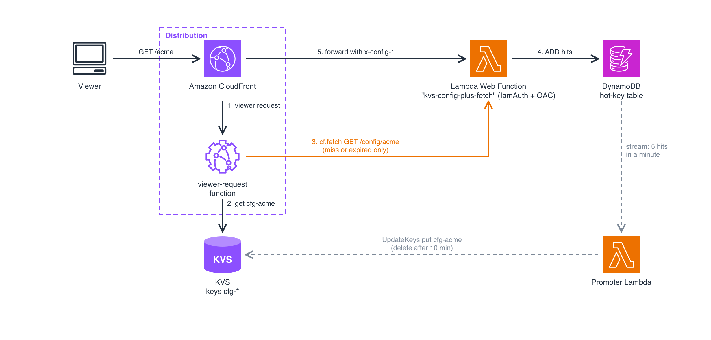
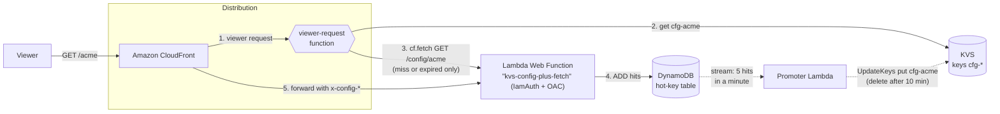
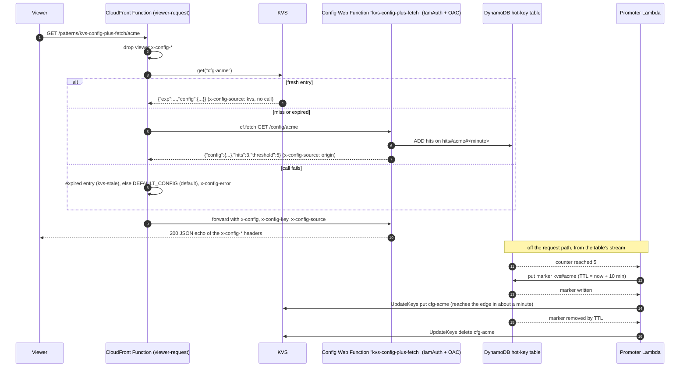

# 07 · kvs-config-plus-fetch

Which config applies to a key, read through KVS: a hit needs no call, a miss is one call to the origin, and hot keys are
promoted into KVS on their own.

Tags: `ai-gateway` `config` · Hooks: viewer-request · Path: `/patterns/kvs-config-plus-fetch/<key>`

## What it does

The function reads the key's config (a tenant's plan, a model route, a rate limit) from KVS. On a miss it calls the origin
once, a Fastify server on a Lambda Web Function that serves the config and counts the read in DynamoDB. A key read 5 times within one minute is hot: a
promoter Lambda, fed by the table's stream, writes it to KVS for 10 minutes, so its next reads are KVS hits with no call. It
fails open: the expired KVS copy, else a built-in default, and the request is always forwarded.

## Architecture





## Sequence diagram



## The function

Key points:

- One path. KVS first; only a missing, unparsable or expired entry makes the call. No KVS associated counts as a miss.
- The KVS value carries its own expiry (`exp`, epoch seconds). An expired entry is read through again, which is also how a
  promoted key picks up a changed config; if that call fails, the expired value still beats the default.
- The function never writes KVS and makes no second call: the origin only counts, and promotion happens behind the stream.

The viewer-request function: [`function.js`](function.js).

## Prerequisites

Node.js 22+, AWS credentials for the target account, Docker or npm for Lambda bundling, and a CDK-bootstrapped
`us-east-1` (`npx cdk bootstrap aws://<account-id>/us-east-1`). Run `npm ci` once at the repository root.

## Deploy this pattern

```sh
npx cdk deploy -c patterns=kvs-config-plus-fetch
```

This deploys the one stack with only this pattern's backend and cache behavior. The `DistributionDomain` output is the
`<domain>` used below. To deploy it next to others, list them: `-c patterns=kvs-config-plus-fetch,hello-fetch`.

No extra step: the demo keys (`acme`, `globex`, and any other valid key) are served by `lambda/source.mjs`. Every deploy
replaces the shared KVS and starts it empty, so promoted keys start over after a deploy.

## Try it

```sh
P=https://<domain>/patterns/kvs-config-plus-fetch
K=demo-$(date +%s)                      # a key nobody has read yet
for i in 1 2 3 4 5; do curl -s "$P/$K" | grep -E '"x-config-(source|hits)"'; done
sleep 70
curl -s "$P/$K" | grep -E '"x-config-(source|hits)"'
curl -s "$P/acme"                       # a known key: plan enterprise
```

| Request | Expected |
|---|---|
| `$P/$K`, reads 1 to 5 | `"x-config-source": "origin"`, `"x-config-hits": "1/5"` up to `"5/5"`, config `{"plan":"free",...}` |
| `$P/$K`, about a minute after the 5th read | `"x-config-source": "kvs"`, no `x-config-hits`: no call was made |
| `$P/$K`, 10 minutes after promotion | `origin` again, counting from 1: the entry expired; 5 more reads in a minute promote it again |
| `$P/acme` | `"x-config": "{\"plan\":\"enterprise\",\"model\":\"large\",\"rateLimit\":1000}"` |
| `$P/Not_A_Key` | 400 from the edge, no call |

Reads past the 5th inside the same minute show `6/5`, `7/5`: the key is promoted but not at this edge yet. The body echoes
the `x-config-*` headers the origin received, under `headersFromFunction`.

## How it fails

| What goes wrong | The viewer gets | Header |
|---|---|---|
| The origin answers non-2xx, bad JSON, or no `config` | the request forwarded with the expired KVS config, else `DEFAULT_CONFIG` | `x-config-source: kvs-stale` or `default`, `x-config-error` |
| `TypeError`, `TimeoutError` (over 1 s), `InternalError` | the same | `x-config-error: <name>: <message>` |
| The counter write fails | the config, served; this read is not counted | no `x-config-hits` |
| The promoter or KVS write fails | nothing changes for the viewer: the key stays a miss | the stream retries 3 times, then the next window promotes it |
| No KVS associated | every read is a miss and makes the call | — |
| Key outside `a-z`, `0-9`, `-`, 1-32 characters | 400 from the function | — |

## Cost

You pay for what a request uses: one CloudFront request, one CloudFront Functions invocation and one KVS read on every
request, and one Lambda Web Function request for the forwarded request. A miss adds one network call, one Web Function
request for `/config/<key>` and one DynamoDB write. Off the request path, a hot key adds Promoter Lambda invocations,
DynamoDB writes for the marker, and KVS `UpdateKeys` calls; the stream's event filter keeps the Promoter from running on
every miss. The DynamoDB table is on-demand: with no traffic it bills only for the data it stores. See
[CloudFront pricing](https://aws.amazon.com/cloudfront/pricing/) (Functions and KeyValueStore),
[Lambda pricing](https://aws.amazon.com/lambda/pricing/) and
[DynamoDB pricing](https://aws.amazon.com/dynamodb/pricing/).

## Security

- The origin is a Lambda Web Function with an `IamAuth` endpoint behind origin access control (OAC, origin type `lambda`,
  signing `always-amz-auth`). Its resource policy lets only CloudFront, for this distribution, invoke the endpoint; a
  direct request to the endpoint domain is refused with 403. The behavior allows GET and HEAD only.
- Viewers reach only `/patterns/kvs-config-plus-fetch/*`; `/config/<key>` is reached only by the function's network call.
- The function drops viewer-supplied `x-config`, `x-config-key`, `x-config-source`, `x-config-hits` and `x-config-error`
  headers; the origin trusts only what the function set. A key outside `a-z`, `0-9`, `-`, 1-32 characters gets a 400 and
  no call.
- The Promoter may only call `DescribeKeyValueStore` and `UpdateKeys` on the shared KVS, and writes only `cfg-` keys. The
  origin and the Promoter may write the table; the function never writes KVS.
- It fails open, on purpose: config is not an access decision, so a failed call serves the expired KVS value, else
  `DEFAULT_CONFIG`, the lowest tier (`plan: free`, `rateLimit: 10`). If your config grants access, decide whether the
  default should deny instead.

## Limits and notes

- **The threshold.** 5 origin reads of one key within one fixed 60 s window (`HOT_THRESHOLD`, `HOT_WINDOW_SECONDS` in
  `pattern.ts`). The counter is one DynamoDB item per key per window (`ADD hits`), so it is exact across every Lambda
  instance, and exactly one read per window sees `hits === 5`: a key is promoted at most once per window. The stream's
  event filter only wakes the promoter for that read and for marker changes, not for every miss.
- **Expiry and refresh.** A promoted value is `{"exp": <now + 600>, "config": {...}}` (`PROMOTE_SECONDS`). After `exp` the
  function treats it as a miss, so a config change at the source reaches a hot key within 10 minutes, and a key that is still
  hot is read 5 more times and promoted again with the new value. Cold keys leave KVS: the marker item `kvs#<key>` has the
  same TTL, and its removal by DynamoDB TTL streams to the promoter, which deletes `cfg-<key>`. DynamoDB TTL can take a few
  days to delete, so `exp` is what keeps reads correct; the delete only keeps the store small.
- **Ordering.** KVS mirrors the marker, not the counter, so the put and the delete for one key come from one item and the
  stream delivers them in order. Promotion writes the marker; the marker's own stream record writes KVS.
- **Propagation.** From the 5th read to a KVS hit at the edge takes about a minute: the stream hops are seconds, the KVS
  write takes 30 to 60 s to reach every edge location. Until then reads keep calling the origin.
- **Size.** KVS values are at most 1 KB (a larger config is never promoted, it stays a call) and the store is 5 MB, shared
  by every pattern, so this pattern only writes keys starting with `cfg-`. Bound the number of hot keys for your traffic: at
  about 100 bytes a value, 10 minutes of promotions must fit next to the other patterns' keys.
- **Read-through, not write-through.** The source of truth is `lambda/source.mjs`, a stand-in for your config service or
  database. A change there is not pushed to KVS; it is picked up when the entry expires. Shorten `PROMOTE_SECONDS`, or have
  your writer delete `cfg-<key>`, when 10 minutes of staleness is too much.
- **The origin is a Fastify server on a Lambda Web Function**
  ([Lambda Web Functions](https://docs.aws.amazon.com/lambda/latest/dg/web-functions.html)): `lambda/app.mjs` builds the
  app, `lambda/index.js` starts it on port 3000, so the same code runs locally with `node lambda/index.js`. The Promoter
  stays a regular Lambda function fed by the stream, packaged from the same folder.
- **A cold origin fails open.** The config origin is a Lambda Web Function, and its first request after idle can take
  over the fixed 1 s, so that read fails open: in our test a read after a deploy took about 2.3 s and was served
  `x-config-source: default` (or `kvs-stale` when an expired entry exists) with
  `x-config-error: TimeoutError: "cloudfront.fetch": Request timed out`, and no `x-config-hits`. Later reads are warm and
  count from where the timed-out ones left off: the origin still counts a read the edge gave up on.
- **AI angle.** The key is a tenant or an API key and the config its model route and quota: the hot tenants are served from
  KVS at the edge with no call, the long tail reads through.

Files:

- `pattern.ts`: the DynamoDB table (TTL, stream), the config Web Function (IamAuth + OAC), the promoter and its stream
  filter, the KVS write grant
- `function.js`: the CloudFront Function
- `lambda/app.mjs`: the origin, a Fastify app: `GET /config/<key>` serves and counts, anything else echoes the `x-config-*`
  headers; `lambda/index.js`: the Web Function entry point, starts it on port 3000
- `lambda/promoter.mjs`, `lambda/hot.mjs`: the stream handler and the pure promotion logic (threshold, window, expiry)
- `lambda/source.mjs`: the stand-in source of truth; `lambda/kvs.mjs`: the KVS writer, the same as 04's
- `test/`: unit tests for the function, the origin (`test/origin.test.mjs`, with `app.inject`), the promotion logic and
  the stack, `node --test patterns/07-kvs-config-plus-fetch/test`
- `architecture.png`: drawn from the Mermaid block under Architecture by `npm run diagrams`

## Clean up

```sh
npx cdk destroy
```

This deletes the stack: the distribution, the KVS, this pattern's DynamoDB table (with its stream), the config Web Function,
the Promoter Lambda function and the stream's event source mapping, and the default-behavior bucket.

The Web Function's log group belongs to the stack and is deleted with it. Log groups the stack did not create outlive it:
the `<log group>.local` group the Web Function service adds next to it,
a plain Lambda function's `/aws/lambda/<function>`, created on first use, and the CloudFront Functions logs
`/aws/cloudfront/function/<function>` in `us-east-1`. Delete them by hand if you do not want to keep the logs.
