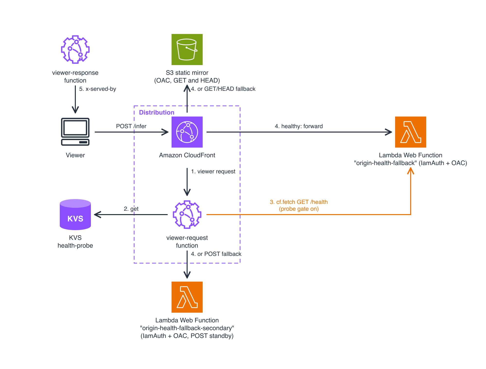
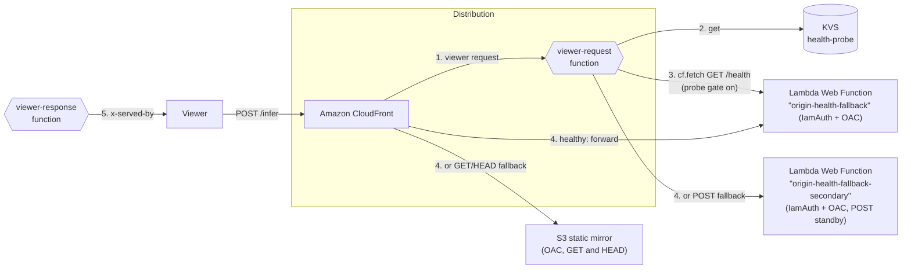
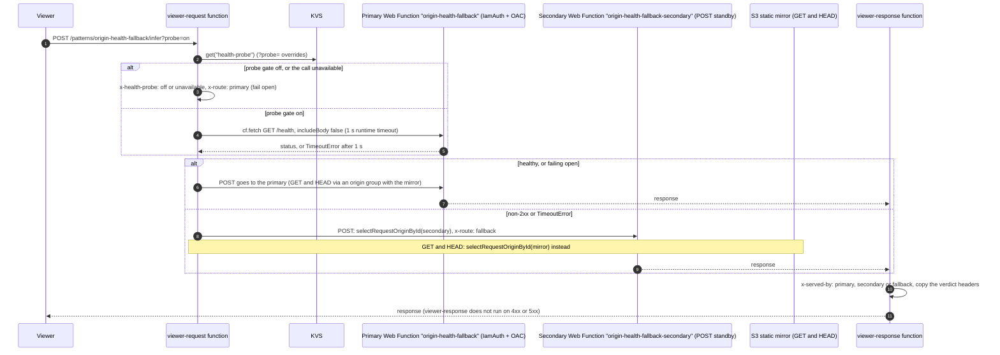

# 08 · origin-health-fallback

Failover for POST: probe the primary's health, and send the POST to a secondary when it is slow or down.

Tags: `ai-gateway` `resilience` · Hooks: viewer-request + viewer-response · Path: `/patterns/origin-health-fallback/*` (all methods)

## What it does

Origin groups cannot fail over a POST. When the probe gate is on, the request function probes `GET /health` on the primary
with one `cf.fetch` and, if it is slow or down, sends the POST to a secondary Lambda Web Function with `cf.selectRequestOriginById`. GET
and HEAD also get a runtime origin group (primary, then an S3 static mirror on 5xx); POST never gets one. A probe that cannot
be made fails open to the primary.

## Architecture





## Sequence diagram



## The function

Key points:

- The gate (`?probe=`, then the KVS key `health-probe`, default `off`) keeps the probe from costing a call per request.
- The probe is a GET with no body read. "Slow" means the runtime's fixed 1 s `TimeoutError`: there is no `timeout` option,
  and `Date.now()` does not advance across the await, so the function does not time the call itself.
- Only `TypeError` (the call itself is invalid) fails open to the primary; any other error is a verdict and fails over.
- The response side makes no call. It maps the origins' `x-origin` marker to `x-served-by` and copies the verdict headers.

The viewer-request function: [`function.js`](function.js).

The viewer-response function: [`response-function.js`](response-function.js).

## Prerequisites

Node.js 22+, AWS credentials for the target account, Docker or npm for Lambda bundling, and a CDK-bootstrapped
`us-east-1` (`npx cdk bootstrap aws://<account-id>/us-east-1`). Run `npm ci` once at the repository root.

## Deploy this pattern

```sh
npx cdk deploy -c patterns=origin-health-fallback
```

This deploys the one stack with only this pattern's backend and cache behavior. The `DistributionDomain` output is the
`<domain>` used below. To deploy it next to others, list them: `-c patterns=origin-health-fallback,hello-fetch`.

The probe gate starts `off`; `?probe=on` turns it on for one request. To turn it on for every request, put the KVS key
`health-probe` = `on` (the command is at the end of Try it), with `KVS_ARN` set to the `KeyValueStoreArn` output. Every
deploy replaces the shared KVS and starts it empty, so put the key again after each deploy.

## Try it

A POST needs no extra header: OAC signs it with an unsigned payload, so the body goes through as it is.

```sh
BODY='{"prompt":"Say hello in one word","max_tokens":8}'
post() { curl -sS -D - -X POST -H 'content-type: application/json' \
  --data "$BODY" "https://<domain>/patterns/origin-health-fallback/infer$1"; }
post                              # 1. no probe
post '?probe=on&simulate=slow'    # 2. primary sleeps 1.5 s
post '?probe=on&simulate=down'    # 3. primary answers 503
curl -sS -D - -o /dev/null 'https://<domain>/patterns/origin-health-fallback/?simulate=down'                     # 4. GET
curl -sS -D - -o /dev/null 'https://<domain>/patterns/origin-health-fallback/about.html?probe=on&simulate=slow'  # 5. GET
```

| | Expected |
|---|---|
| 1 | 200 from the primary, `x-served-by: primary`, `x-health-probe: off` (probe gate off, no call) |
| 2 | 200 from the secondary: `x-served-by: secondary`, `x-fallback: true`, `x-route: fallback`, `x-health-probe: unhealthy:timeout`, `x-health-probe-error: TimeoutError: "cloudfront.fetch": Request timed out`, body `"servedBy":"secondary"` (after about 1 s) |
| 3 | 200 from the secondary, `x-health-probe: unhealthy:503` (without the probe: 503 `primary: simulated outage`, no failover for POST, and no `x-served-by` because viewer-response did not run) |
| 4 | 200 from S3: `x-served-by: fallback`, `x-route: primary` (the GET origin group failed over, no call involved) |
| 5 | the mirror's `about.html`: `x-served-by: fallback`, `x-route: fallback`, `x-health-probe: unhealthy:timeout` |

Row 3 is the whole argument: without the probe a POST outage is an outage, with it a 200. Turn the probe on for everyone:

```sh
aws cloudfront-keyvaluestore put-key --kvs-arn "$KVS_ARN" --key health-probe --value on \
  --if-match "$(aws cloudfront-keyvaluestore describe-key-value-store --kvs-arn "$KVS_ARN" --query ETag --output text)"
```

## How it fails

| What goes wrong | Where the request goes | Header |
|---|---|---|
| Probe 2xx (in under 1 s) | primary | `x-health-probe: ok` |
| Probe non-2xx | secondary or mirror | `x-health-probe: unhealthy:<status>` |
| `TimeoutError` (over 1 s), `InternalError` or any other error | secondary or mirror | `x-health-probe: unhealthy:timeout` or `unhealthy:error`, `x-health-probe-error` |
| `TypeError: ... could not be completed due to <result type>`: the edge could not reach the primary (`OriginDnsError`, `OriginConnectError`, `OriginCommError`, `AbortedOrigin`) | secondary or mirror | `x-health-probe: unhealthy:error`, `x-health-probe-error` |
| Any other `TypeError`: the call itself is invalid | primary (fail open) | `x-health-probe: unavailable`, `x-health-probe-error` |
| The origin helpers throw | primary | `x-route-error` |

## Cost

You pay for what a request uses: one CloudFront request and one CloudFront Functions invocation for the request function
on every request, plus one for the response function when the answer is under 400. With the gate off, the function reads
one KVS key (unless `?probe=` is set) and makes no call. With the gate on, each request adds one network call and one
primary Web Function invocation for `/health`. The request itself is one Web Function invocation (primary or secondary) or one S3 GET
from the mirror. When idle, the two Secrets Manager secrets and the mirror's objects in S3 still bill. See
[CloudFront pricing](https://aws.amazon.com/cloudfront/pricing/),
[Lambda pricing](https://aws.amazon.com/lambda/pricing/),
[S3 pricing](https://aws.amazon.com/s3/pricing/) and
[Secrets Manager pricing](https://aws.amazon.com/secrets-manager/pricing/).

## Security

- The primary and the secondary are Lambda Web Functions with an `IamAuth` endpoint behind origin access control (OAC,
  origin type `lambda`, signing `always-amz-auth`). CloudFront signs every origin request, the probe included, and each
  function's resource policy lets only this distribution invoke its endpoint; a direct request to the endpoint domain is
  refused with 403.
- Each origin has its own secret `x-origin-verify` header, which CloudFront adds on every origin request, the probe
  included; without it the origin answers 403.
- The mirror is a private S3 bucket: all public access blocked, SSL enforced, S3-managed encryption, and a bucket policy
  that lets only this distribution read it through OAC.
- The request function drops viewer-supplied `x-route`, `x-route-error`, `x-health-probe` and `x-health-probe-error`
  headers. The origins send their internal `x-origin` marker only on answers below 400, and the response function (which
  runs only on those) removes it before the viewer sees it. An error answer carries no marker.
- `?probe=` and `?simulate=` are demo switches any viewer can set: `?probe=on` costs a call, and `?simulate=down|slow`
  makes the primary fail for that request only (the secondary ignores it). Remove both before you reuse the code.
- It fails open to the primary when the call itself is invalid (`TypeError` other than an unreachable origin), when the
  KVS read fails, and when the origin helpers throw: none of these says the primary is down. Every other probe failure
  fails over, because it says the primary is slow or down.
- **The shared origin secret is a second lock, and it is visible.** CDK unwraps it at deploy time, so its value is in the
  CloudFormation template, the origin's environment and the distribution's custom-header configuration. The origin is
  already locked by IAM auth and origin access control. For production, pass only the secret's ARN to the origin and
  read the value at run time with a scoped read grant, and rotate the secret together with the CloudFront header.

## Limits and notes

| | Origin group | GET probe + `cf.selectRequestOriginById` | viewer-response |
|---|---|---|---|
| POST, primary 5xx or slow | no: groups fail over GET, HEAD, OPTIONS only | yes, to the secondary | never invoked on 5xx |
| GET/HEAD, primary 5xx | yes, same path on the mirror | yes, mirror selected directly | no |
| GET/HEAD, primary slow | waits for the origin timeout | yes | no |
| Cost per request | none | one call, only when the probe gate is on | none |

- **For POST, the request function is the failover.** Decide before the request is sent: probe, then select an origin that
  already exists on the distribution (the secondary and the mirror are extra origins with no behavior).
- **The 1 s timeout is the budget.** The slow primary sleeps 1.5 s, past the runtime's fixed 1 s, so step 2 shows
  `unhealthy:timeout` and routes to the secondary; the viewer pays about 1 s for the probe. A primary that answers 2xx in
  under 1 s counts as healthy, however slow: `Date.now()` does not advance across an awaited `cf.fetch`, so a tighter
  self-timed budget would never fire. If you need a tighter limit, have `/health` itself answer non-2xx when the primary
  is degraded.
- **A cold primary fails over, not open.** The primary is a Lambda Web Function, and its first request after idle can
  take over the fixed 1 s. A probe that hits it then times out, `unhealthy:timeout`, and that request goes to the
  secondary or the mirror; later probes are warm.
- **Fail open on anything that says nothing about the origin.** A `TypeError` for a bad call (bad argument, unknown origin id)
  sends traffic to the primary; non-2xx, `TimeoutError`, `InternalError` or any other error fails over. The runtime also
  throws a `TypeError` when the edge cannot reach the origin (DNS, TLS, connection), with the
  `x-edge-detailed-result-type` in the message (`... could not be completed due to OriginDnsError`): that one says the
  primary is down, so it fails over too.
- **The response hook annotates, nothing more.** `x-served-by` comes from a marker the two Web Functions set on answers
  below 400 (`x-origin`, removed before the viewer sees it); no marker means S3 answered. Compare it with `x-route` to tell "probe decided" from "group failed
  over".
- **AI angle.** Inference is POST, uncached and never retried by an origin group: probe the primary model endpoint, then
  send the prompt once, to the endpoint that is up (another Region, another provider behind its own gateway).
- **The origins are Fastify servers on Lambda Web Functions.** One code package, two functions (`ROLE=primary` or
  `secondary`); see [Lambda Web Functions](https://docs.aws.amazon.com/lambda/latest/dg/web-functions.html).

Files:

- `pattern.ts`: the primary Web Function (IamAuth + OAC, through `WebFunctionOrigin`) as the behavior origin; the
  secondary Web Function and the S3 mirror as `extraOrigins`; `keyValueStore: true`; both hooks; all methods allowed
- `function.js`: viewer-request, the probe gate, GET probe, secondary or mirror selection, the GET/HEAD origin group
- `response-function.js`: viewer-response, `x-served-by`, `x-fallback`, the copied verdict headers
- `lambda/app.mjs`: the Fastify app for the primary and the secondary (`ROLE=secondary`): `/health`, POST echo, HTML pages,
  `?simulate=down|slow` on the primary only
- `lambda/index.js`: the Web Function entry point, starts the app on port 3000
- `objects/`: the static mirror, same paths as the primary serves
- `function.test.mjs`, `test/origin.test.mjs`: unit tests,
  `node --test patterns/08-origin-health-fallback/*.test.mjs patterns/08-origin-health-fallback/test/*.test.mjs`
- `demo.json`: the demo card
- `architecture.png`: drawn from the Mermaid block under Architecture by `npm run diagrams`

## Clean up

```sh
npx cdk destroy
```

This deletes the stack: the distribution, the KVS, this pattern's primary and secondary Web Functions and their two
secrets, the mirror bucket with its objects (`autoDeleteObjects`), and the demo bucket.

The Web Function's log group belongs to the stack and is deleted with it. Log groups the stack did not create outlive it:
the `<log group>.local` group the Web Function service adds next to it,
a plain Lambda function's `/aws/lambda/<function>`, created on first use, and the CloudFront Functions logs
`/aws/cloudfront/function/<function>` in `us-east-1`. Delete them by hand if you do not want to keep the logs.
