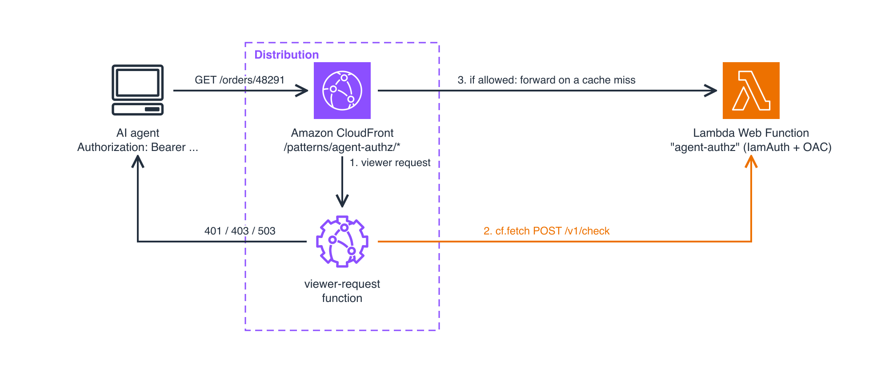
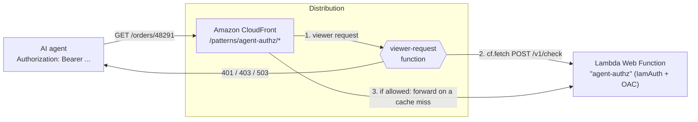
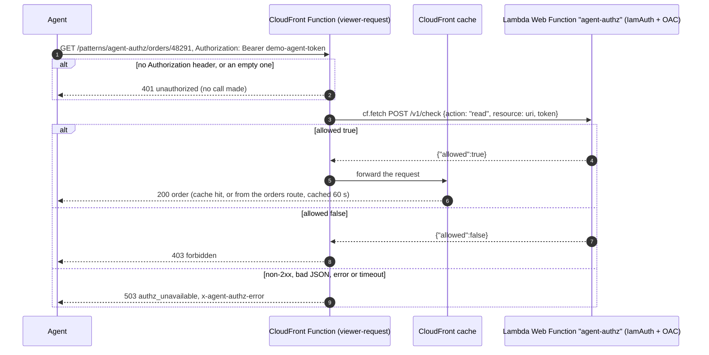

# 09 · agent-authz

Ask an authorization service whether this AI agent may read or write this resource, then forward, or answer 401, 403 or 503.

Tags: `agents` `auth` · Hooks: viewer-request · Path: `/patterns/agent-authz/*`

## What it does

An AI agent sends a short-lived scoped token on every request. The token says who the agent is, but not whether it may act
on this resource right now. So the function POSTs `{ action, resource, token }` to an authorization service with one
`cf.fetch` and forwards the request only when the answer is `{ "allowed": true }`. Denied requests never reach the backend,
and allowed reads can still be cache hits because viewer request runs before the cache. It **fails closed**: a service that
cannot be asked denies with 503.

## Architecture





## Sequence diagram



One Fastify app on the Web Function serves both routes: `POST /v1/check` is the authorization service, and every other path is the orders backend.
Viewer requests always arrive under `/patterns/agent-authz/...`, so a viewer cannot reach `/v1/check` through CloudFront.

## The function

Key points:

- No `Authorization` header, or an empty or blank one, is a 401 answered by the function, before any call, so anonymous traffic costs nothing at the
  authorization service.
- `action` comes from the method (`GET` and `HEAD` are `read`, everything else is `write`) and `resource` is the URI.
- The token travels in the JSON body, not as the call's `authorization` header: OAC signs the call and puts its own
  signature in that header, so a token sent there would never reach the service. The POST needs no body hash header:
  the OAC signs it with an unsigned payload.
- Only exactly `allowed: true` passes. Denials are `no-store`.

The viewer-request function: [`function.js`](function.js).

## Prerequisites

Node.js 22+, AWS credentials for the target account, Docker or npm for Lambda bundling, and a CDK-bootstrapped
`us-east-1` (`npx cdk bootstrap aws://<account-id>/us-east-1`). Run `npm ci` once at the repository root.

## Deploy this pattern

```sh
npx cdk deploy -c patterns=agent-authz
```

This deploys the one stack with only this pattern's backend and cache behavior. The `DistributionDomain` output is the
`<domain>` used below. To deploy it next to others, list them: `-c patterns=agent-authz,hello-fetch`. No step after the
deploy: the demo policy and the demo token are in the origin code.

## Try it

The demo token is `demo-agent-token`. It is a fixed, public demo value, not a secret, and it grants one thing: read
`/patterns/agent-authz/orders/48291`.

```sh
export DOMAIN=<domain>
export TOKEN="Authorization: Bearer demo-agent-token"
curl -si "https://$DOMAIN/patterns/agent-authz/orders/48291"                       # 1. no token
curl -si "https://$DOMAIN/patterns/agent-authz/orders/70113" -H "$TOKEN"            # 2. other order
curl -si "https://$DOMAIN/patterns/agent-authz/orders/48291" -H "$TOKEN"            # 3. allowed order
curl -si "https://$DOMAIN/patterns/agent-authz/orders/48291" -H "$TOKEN"            # 4. repeat, within 60 s
curl -si -X PUT "https://$DOMAIN/patterns/agent-authz/orders/48291" -H "$TOKEN"     # 5. write
```

| Step | Expected |
|---|---|
| 1 | 401 `{"error":"unauthorized"}`, `www-authenticate: Bearer` |
| 2, 5 | 403 `{"error":"forbidden"}` |
| 3 | 200 `{"order":"48291","status":"shipped","servedAt":"..."}` |
| 4 | a repeat request usually shows `x-cache: Hit from cloudfront` within a few tries, with the same body and `servedAt` as the request that filled the cache. The first repeat can still be a `Miss` with a new `servedAt`: a POP has several cache hosts, and a request that lands on another one before the object reaches it goes to the origin again |

## How it fails

| What goes wrong | The viewer gets | Header |
|---|---|---|
| No `Authorization` header, or an empty or blank one | 401 `unauthorized` (no call made) | `www-authenticate: Bearer` |
| The service says anything but `allowed: true` | 403 `forbidden` | — |
| The service answers non-2xx | 503 `authz_unavailable` | `x-agent-authz-error: authz returned <status>` |
| `TypeError`, `TimeoutError` (over 1 s), `InternalError`, a body that is not JSON | 503 `authz_unavailable` | `x-agent-authz-error: <name>: <message>` |

`authz returned 403` means the call reached the Web Function endpoint but failed its lock: the OAC signature (the
resource policy allows this distribution only) or the `x-origin-verify` custom header.

## Cost

You pay for what a request uses: one CloudFront request and one CloudFront Functions invocation each time. A request with
no `Authorization` header, or an empty one, stops there. Any other request adds one network call and one Web Function request for
`/v1/check`; an allowed request that misses the cache adds a second Web Function request for the order. A cache hit adds
no second request. The origin secret is one Secrets Manager secret, billed per month. Nothing else runs when there is no
traffic. See [CloudFront pricing](https://aws.amazon.com/cloudfront/pricing/),
[Lambda pricing](https://aws.amazon.com/lambda/pricing/) and
[Secrets Manager pricing](https://aws.amazon.com/secrets-manager/pricing/).

## Security

- The origin is a Lambda Web Function with an `IamAuth` endpoint behind origin access control (OAC, origin type `lambda`,
  signing `always-amz-auth`), so CloudFront signs every origin request, the `cf.fetch` call included. The function's
  resource policy lets `cloudfront.amazonaws.com` invoke the endpoint for this distribution only; a direct request to the
  endpoint domain is refused with 403.
- CloudFront adds a secret `x-origin-verify` header on every origin request, the `cf.fetch` call included; the origin
  refuses any request without it, on both routes.
- `/v1/check` cannot be reached by a viewer: viewer requests always arrive under `/patterns/agent-authz/...`, and only the
  function calls `/v1/check`.
- The function strips no viewer headers. It does not need to: the decision comes from the service's answer, not from a
  header, and it sends the token in the call's JSON body because OAC signs the call and owns its `authorization` header.
- It **fails closed**: no token is a 401, any answer but exactly `allowed: true` is a 403, and a service that cannot be
  asked (non-2xx, error, timeout, bad JSON) is a 503. Denials are `no-store`, so a refusal is never cached.
- The demo token is a fixed, public value that grants one read. A real service checks a signed, short-lived token.
- **The shared origin secret is a second lock, and it is visible.** CDK unwraps it at deploy time, so its value is in the
  CloudFormation template, the origin's environment and the distribution's custom-header configuration. The origin is
  already locked by IAM auth and origin access control. For production, pass only the secret's ARN to the origin and
  read the value at run time with a scoped read grant, and rotate the secret together with the CloudFront header.

## Limits and notes

- **Authorize every request, cache the content.** The behavior uses `CachingOptimized`, which leaves the token out of the
  cache key, so one cached order serves every agent the service allows. The function still runs on every request, cache hits
  included, so a grant revoked a second ago is refused on the next request.
- **One origin here, two in production.** The demo origin is both the service and the backend. A real authorization service
  is usually its own origin: add it with `extraOrigins` and change `originId` in the function.
- **Agents angle.** The agent's token is scoped to a task, not to a resource list. The service holds the per-resource policy
  and can change it between two calls, which a token minted earlier cannot express.
- The origin is a Fastify server on a
  [Lambda Web Function](https://docs.aws.amazon.com/lambda/latest/dg/web-functions.html); the unit tests drive it with
  `app.inject`, without a network.

Files:

- `pattern.ts`: the secret, the Web Function origin (IamAuth endpoint behind OAC), and the cacheable behavior
- `function.js`: the CloudFront Function
- `lambda/app.mjs`: the Fastify app, `POST /v1/check` (the demo policy: `demo-agent-token` may read order `48291`) and the
  orders route
- `lambda/index.js`: starts the app on the Web Function's port
- `test/function.test.mjs`: unit tests for the CloudFront Function
- `test/origin.test.mjs`: unit tests for the origin, with `app.inject`; run both with
  `node --test 'patterns/09-agent-authz/test/*.test.mjs'`
- `demo.json`: the demo card
- `architecture.png`: drawn from the Mermaid block under Architecture by `npm run diagrams`

## Clean up

```sh
npx cdk destroy
```

This deletes the stack: the distribution, the KVS, this pattern's Lambda Web Function and secret, and the demo bucket.

The Web Function's log group belongs to the stack and is deleted with it. Log groups the stack did not create outlive it:
the `<log group>.local` group the Web Function service adds next to it,
a plain Lambda function's `/aws/lambda/<function>`, created on first use, and the CloudFront Functions logs
`/aws/cloudfront/function/<function>` in `us-east-1`. Delete them by hand if you do not want to keep the logs.
