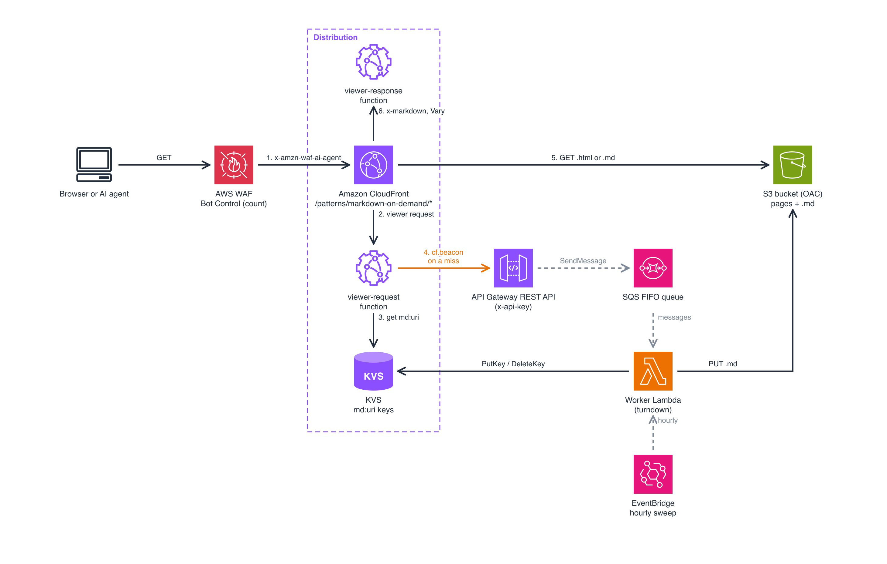
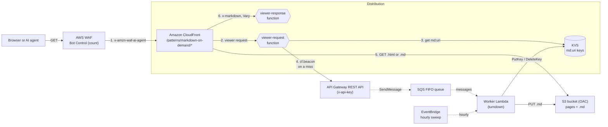
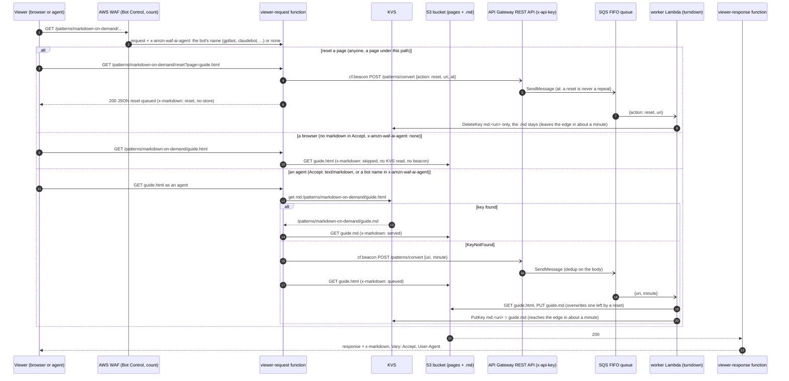

# 10 · markdown-on-demand

Serve AI agents a markdown copy of a page; when there is none yet, serve the HTML and `cf.beacon` a conversion job into SQS.

Tags: `agents` `ai-gateway` · Hooks: viewer-request + viewer-response · Path: `/patterns/markdown-on-demand/*`

For the full solution (several formats, the generation pipeline, a dashboard), see
[Automated format conversion for AI agents](https://github.com/aws-samples/sample-automated-markdowns-for-agents-using-cloudfront-and-waf).

## What it does

Agents read text, not layout, and a markdown copy of a page costs them far fewer tokens than the HTML. The request
function spots an agent (`Accept: text/markdown`, or an AI bot that AWS WAF Bot Control labelled) and looks up `md:<uri>` in KVS, which
costs no network call. A hit rewrites the URI to the `.md` object in S3. A miss serves the HTML as usual and fires one
`cf.beacon` with the page URI into an SQS FIFO queue (the [05](../05-edge-signal-sqs/) shape: API Gateway, no Lambda in the
request path); a worker converts the page offline and writes the `.md` and the KVS key. It fails open: the agent always gets
at least the HTML. `GET reset?page=<page>` sends a second kind of message down the same queue, which deletes the page's KVS
key, and an hourly sweep deletes all of them, so a first conversion can always be shown again.

## Architecture





## Sequence diagram



## The function

Key points:

- **No second call to ask "is there markdown?".** A function gets one call per invocation, and the beacon is it. The worker
  writes `md:<uri>` to KVS after it stores the `.md`, so a KVS read answers the question for free.
- **The beacon body is the URI and the minute, `{ "uri": ..., "minute": ... }`.** The FIFO queue uses content-based
  deduplication, so a burst of agents asking for the same page within a minute is one message and one conversion. The
  worker converts and overwrites on every message, so a repeat is harmless. The minute is there for resets: a bare
  `{ uri }` would match the page's first conversion for 5 minutes, and the queue would silently drop the request to
  convert it again.
- **A reset is a message too, never a second call.** `reset?page=guide.html` beacons `{ "action": "reset", uri, at }` to
  the same queue and answers itself with JSON (`no-store`). `at` is a timestamp, so a reset is never deduplicated with an
  earlier one. Only a page this function would convert can be named, so a reset can never delete another key.
- **A reset deletes the key, never the `.md`.** The delete takes about a minute to reach every edge location, and until
  then an edge still rewrites agents to the `.md`. Deleting the object too would make those requests miss in S3. The next
  conversion overwrites it.
- **AWS WAF says who is an AI bot, not a user-agent list in the function.** Bot Control knows far more AI crawlers and
  assistants than a regex would, and its list is kept current for you. WAF writes `x-amzn-waf-ai-agent` on every request
  here (see [The AWS WAF rules](#the-aws-waf-rules)), so the function only compares one header with `none`.
- **Only pages beacon**: `.html` under this path, no dots elsewhere in the URI, and a folder means its `index.html`. The
  worker accepts exactly the same URIs, so a message can never name another object.
- **Viewer-supplied `x-markdown` headers are dropped.** The response function copies the function's verdict onto the
  response, because an S3 origin echoes nothing; it makes no network call. A reset answer comes from the function itself,
  so viewer-response does not run and the function sets `x-markdown: reset` directly.

The viewer-request function: [`function.js`](function.js).

The viewer-response function: [`response-function.js`](response-function.js).

## The AWS WAF rules

[`pattern.ts`](pattern.ts) sets `botControl: true`, so the distribution's shared web ACL runs Bot Control (common level,
**count**: it labels, never blocks) on this path before the two rules it contributes, each scoped to
`/patterns/markdown-on-demand/`:

| Rule | Action | Why |
|---|---|---|
| `markdown-on-demand-not-an-agent` | **count**, insert header `ai-agent: none` | every request here gets the header, so a viewer-supplied `x-amzn-waf-ai-agent` is always overwritten |
| `markdown-on-demand-ai-agent` | **count** on label `awswaf:managed:aws:bot-control:bot:category:ai`, insert header `ai-agent: ${awswaf:managed:aws:bot-control:bot:name:}` | [dynamic label interpolation](https://aws.amazon.com/blogs/security/do-more-with-aws-waf-labels-using-dynamic-label-interpolation/) puts the bot's name in the value; it runs last, and the last matching rule's header wins |

WAF prefixes every header it inserts, so the function reads `x-amzn-waf-ai-agent`.

## Prerequisites

Node.js 22+, AWS credentials for the target account, Docker or npm for Lambda bundling, and a CDK-bootstrapped
`us-east-1` (`npx cdk bootstrap aws://<account-id>/us-east-1`). Run `npm ci` once at the repository root.

## Deploy this pattern

```sh
npx cdk deploy -c patterns=markdown-on-demand
```

This deploys the one stack with only this pattern's backend and cache behavior. The `DistributionDomain` output is the
`<domain>` used below. To deploy it next to others, list them: `-c patterns=markdown-on-demand,hello-fetch`. No step
after the deploy: the stack creates the web ACL with Bot Control and the two rules, seeds the sample pages from `objects/`,
and stores the API key in Secrets Manager. It also outputs `QueueUrl` and `PagesBucket`.

## Try it

```sh
D=https://<domain>/patterns/markdown-on-demand
curl -si $D/guide.html | grep -iE '^(content-type|x-markdown)'                             # 1. a browser
curl -si -H 'Accept: text/markdown' $D/guide.html | grep -iE '^(content-type|x-markdown)'  # 2. an agent, first time
sleep 60
curl -si -H 'Accept: text/markdown' $D/guide.html                                          # 3. the same agent, a minute later
curl -si -A 'GPTBot/1.2' $D/ | grep -iE '^(content-type|x-markdown)'                       # 4. an AI bot to Bot Control, a folder
curl -s "$D/reset?page=guide.html"                                                         # 5. forget guide.md
sleep 60
curl -si -H 'Accept: text/markdown' $D/guide.html | grep -iE '^(content-type|x-markdown)'  # 6. an agent again: queued
```

| Step | Expected |
|---|---|
| 1 | 200 `text/html`, `x-markdown: skipped` |
| 2 | 200 `text/html`, `x-markdown: queued`: the page as usual, plus one message in the queue |
| 3 | 200 `text/markdown; charset=utf-8`, `x-markdown: served`, body `---\ntitle: "Guide: serving markdown to AI agents"\n---\n\n# Serving markdown to AI agents ...` |
| 4 | first time `index.html` with `x-markdown: queued`; a minute later `index.md`, `x-markdown: served`. Bot Control labels GPTBot's user agent `bot:category:ai` even from curl (unverified), and the function sees `x-amzn-waf-ai-agent: gptbot`. Bot Control decides, not a list here: a curl claiming `ClaudeBot/1.0` is labelled an AI bot too and gets `served`, while one claiming `Claude-User/1.0` gets `none` and `skipped` |
| 5 | 200 `application/json`, `x-markdown: reset`: `{"reset":"queued","uri":"/patterns/markdown-on-demand/guide.html",...}`, one reset message in the queue |
| 6 | 200 `text/html`, `x-markdown: queued`, and a minute later step 3 again |

The reset deletes the KVS key at once, but the delete takes about 30-60 s to reach the edge, like any KVS write: for that
minute an agent request may still see the old pointer and get the old `.md` (`x-markdown: served`), which the reset leaves
in place for exactly this reason. Wait a minute after step 5. The deployed sample also resets itself: an hourly EventBridge
schedule runs the worker with no messages, and it deletes every `md:` key for this pattern's pages.

If step 3 still says `queued`, the KVS write has not reached that edge location yet: KVS writes took about 30-60 s to reach
the edge in our measurements (see [04](../04-ab-global-table/)), plus a few seconds of conversion. Each extra `queued` is one
more beacon, deduplicated by the queue within the minute; a later one converts the page again, to the same `.md`. The worker logs one line per message:

```sh
aws logs tail /aws/lambda/$(aws cloudformation list-stack-resources --stack-name FoundationStack \
  --query "StackResourceSummaries[?ResourceType=='AWS::Lambda::Function' && contains(LogicalResourceId,'markdownondemandWorker')].PhysicalResourceId" \
  --output text) --since 10m
```

Use `list-stack-resources`, not `describe-stack-resources`: the latter returns only the first 100 resources of a stack, and
the stack with every pattern has more, so the worker can be missing from it and the command tails nothing.

`{"messageId":"...","result":"converted","uri":"/patterns/markdown-on-demand/guide.html"}`, then
`reset` for a reset, and `{"sweep":{"keys":2}}` for the hourly sweep. To convert a page
again, reset it (step 5).

## How it fails

| What goes wrong | The viewer gets | Header |
|---|---|---|
| Not an agent, or not a page | the object as usual | `x-markdown: skipped` |
| `cf.beacon` throws (a bad option, a second call) | the HTML | `x-markdown: failed`, `x-markdown-error` |
| The beacon is dropped after the function returned (best effort) | the HTML | `x-markdown: queued`; the failure is in CloudWatch Logs (`logDeliveryErrors`). The next agent request beacons again |
| The worker fails (S3, KVS throttling) | the HTML, meanwhile | `x-markdown: queued`; SQS retries the message until it succeeds or expires after 1 day |
| The KVS key has not reached this edge location | the HTML | `x-markdown: queued` again; deduplicated within the minute, and a later message overwrites the same `.md` and key |
| The page does not exist | 403 from S3 (OAC grants read only, no list) | none: viewer-response does not run on 400 or higher. The beacon was still sent; the worker drops the message |
| The `.md` was deleted but `md:<uri>` was not | 403 from S3 | none; delete the key too |
| An agent asks within a minute of a reset or the sweep | the old `.md`: the edge still has the key, and the object is kept | `x-markdown: served`; once the delete reaches the edge, `queued` |
| `reset?page=` names no page under this path | 400 JSON from the function, no beacon | `x-markdown: invalid` |
| A reset is dropped (best effort) | 200 JSON as usual | `x-markdown: reset`; the key is not deleted, so send it again |

## Cost

You pay for what a request uses. Every request on this path is one CloudFront request, one AWS WAF web ACL evaluation
with its rules, one Bot Control inspection, and one CloudFront Functions invocation on viewer request. An agent request
adds a KVS read. Every request but a reset goes to S3, because the behavior does not cache: one S3 GET. An S3 answer of
2xx or 3xx adds the viewer-response invocation.

**Each beacon is a billed network call.** Only an agent request for a page with no markdown yet, or a reset, beacons;
browsers, hits and assets never do. Until the KVS key arrives, every agent request for that page beacons again, which
costs calls but not conversions. Each beacon that arrives is one API Gateway REST API request and one SQS FIFO
`SendMessage`; each message is one worker Lambda invocation with S3 and KVS API calls.

Some resources bill when there is no traffic:

- the AWS WAF web ACL and each rule in it, per month, and the Bot Control rule group, per month. Bot Control is also
  billed per request it inspects, which is why the shared rule group is scoped to the paths of the patterns that ask for
  it;
- the hourly EventBridge schedule, which invokes the worker every hour;
- the Lambda event source, which polls the SQS queue with receive requests;
- the Secrets Manager secret that holds the API key, per month;
- S3 storage for the pages and the `.md` copies.

The API Gateway REST API has no charge without requests. See [CloudFront pricing](https://aws.amazon.com/cloudfront/pricing/),
[AWS WAF pricing](https://aws.amazon.com/waf/pricing/), [API Gateway pricing](https://aws.amazon.com/api-gateway/pricing/),
[SQS pricing](https://aws.amazon.com/sqs/pricing/), [Lambda pricing](https://aws.amazon.com/lambda/pricing/),
[S3 pricing](https://aws.amazon.com/s3/pricing/), [EventBridge pricing](https://aws.amazon.com/eventbridge/pricing/) and
[Secrets Manager pricing](https://aws.amazon.com/secrets-manager/pricing/).

## Security

- The pages bucket blocks all public access, enforces TLS, and is read through origin access control (OAC), read only.
  CDK writes the bucket policy for this distribution only, so a missing page is a 403, not a 404.
- The queue API is a regional API Gateway REST API that requires an API key on its one method. CloudFront sends the key
  as an `x-api-key` custom header on every request to that origin, the beacon included. The key value is a Secrets
  Manager secret. An API key identifies the caller; it is not strong authorization, so treat it as the demo's lock.
- API Gateway sends to the queue with its own IAM role, which can only send messages to that queue. The worker can read
  under `patterns/markdown-on-demand/`, write only `.md` objects there, and use only the shared KVS.
- The request function deletes viewer-supplied `x-markdown` and `x-markdown-error` headers, so only the function sets
  the verdict the response function copies. AWS WAF overwrites `x-amzn-waf-ai-agent` on every request to this path (see
  [The AWS WAF rules](#the-aws-waf-rules)); the function trusts that header only because of this.
- Only `.html` pages under this path beacon or can be reset, and the worker accepts exactly the same URIs, so a message
  can never name another object or another KVS key.
- It **fails open**: a failed KVS read, a failed or dropped beacon, or a failed worker still serves the HTML. Markdown is
  an optimization, not a gate.
- The reset path is open to anyone in the demo; see the note under Limits and notes.
- **The API key is visible.** CDK unwraps it at deploy time, so its value is in the CloudFormation template and the
  distribution's custom-header configuration; anyone who can read either can call the API directly. Keep the usage plan
  throttling, restrict who can read the stack and distribution, and rotate the key together with the CloudFront header.

## Limits and notes

- **A beacon is best effort.** Nothing tells the function it was delivered, so nothing must depend on it: a lost beacon only
  delays the markdown until the next agent request.
- **Detection is a hint, not a gate.** `Accept: text/markdown` is the agent asking for markdown, and `bot:category:ai`
  also matches a client that only claims an AI user agent: a browser that pretends gets the same public content as text.
  To act on verified bots only, match `awswaf:managed:aws:bot-control:bot:verified` (or `bot:web_bot_auth:verified`) in the
  `ai-agent` rule too. Key on Bot Control labels, as the
  [markdown for agents sample](https://github.com/aws-samples/sample-automated-markdowns-for-agents-using-cloudfront-and-waf)
  does. Without the web ACL nothing writes the header, and a viewer could send it; the function trusts it only because WAF
  overwrites it on every request. This pattern reuses that sample's converter (turndown), its KVS marker per URI and its URI-deduplicated FIFO queue,
  with `cf.beacon` as the trigger instead of a log subscription.
- **Caching.** The behavior does not cache. If you turn caching on, put the agent signal in the cache key (for example a
  normalized `Accept`), or a cached HTML copy is served to agents; `Vary: Accept, User-Agent` tells downstream caches the
  same.
- **Stale markdown.** The `.md` is made once. When a page changes, reset it (a publish pipeline can send the same reset
  message to the queue), or keep a timestamp in the KVS value and re-convert when it is older than the page.
- **The reset and the sweep are for the demo.** Anyone can reset a page here, which only costs a re-conversion. In
  production put the reset behind auth, or send the message from the publish pipeline and drop the path. KVS has no TTL,
  so the sweep is what returns the deployed sample to "not converted" every hour. The `.md` objects stay: without a key no
  agent is sent to them, and the next conversion overwrites them.
- **Missing pages still beacon.** The request function cannot know the page exists. Beacon from the viewer-response function
  instead, which runs only on a 2xx or 3xx, if requests for missing pages are a real cost.
- **The worker reads the HTML from the bucket**, not through the distribution, so it never triggers itself. For a dynamic
  origin, fetch the page through the distribution with a header the function skips.
- **AI angle.** Agents that crawl documentation or a catalog get compact markdown without anyone pre-generating every page,
  and only the pages agents actually ask for are converted.

Files:

- `pattern.ts`: the AWS WAF rules that write `x-amzn-waf-ai-agent`, the pages bucket (OAC), the queue API (API Gateway -> SQS FIFO, an extra origin), the worker Lambda and its
  KVS and S3 grants, and the hourly EventBridge sweep
- `function.js`: the viewer-request function
- `response-function.js`: the viewer-response function (no call)
- `lambda/index.mjs`, `lambda/worker.mjs`, `lambda/convert.mjs`: the worker wiring, its logic (convert, reset, sweep), and
  the turndown converter
- `objects/`: the sample pages, seeded at deploy
- `test/`: unit tests for both functions and the worker logic, `node --test patterns/10-markdown-on-demand/test`;
  `lambda/test/` tests the converter (`cd lambda && npm ci && npm test`)
- `architecture.png`: drawn from the Mermaid block under Architecture by `npm run diagrams`

## Clean up

```sh
npx cdk destroy
```

This deletes the stack: the distribution, the AWS WAF web ACL, the KVS, the pages bucket with its pages and `.md` copies
(the bucket empties itself on delete), the API Gateway REST API and its API key, the secret, the SQS queue, the worker
Lambda, the hourly EventBridge rule, and the default-behavior bucket.

CloudWatch Logs log groups outlive the stack: Lambda creates `/aws/lambda/<function>` on first use, and CloudFront Functions
log to `/aws/cloudfront/function/<function>` in `us-east-1`. Delete them by hand if you do not want to keep the logs.
