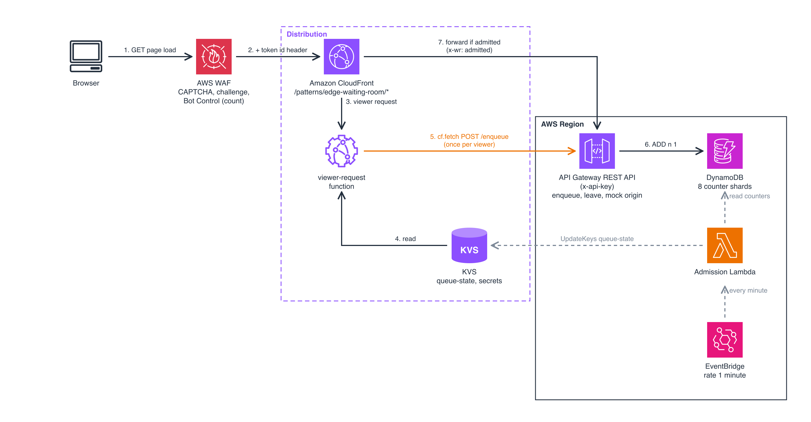
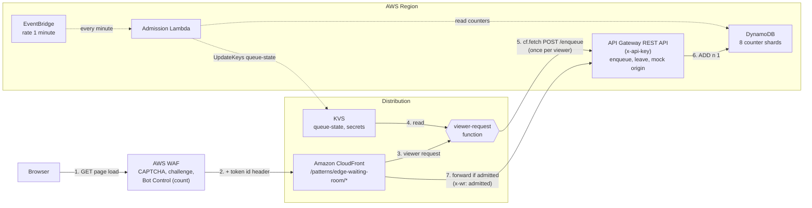
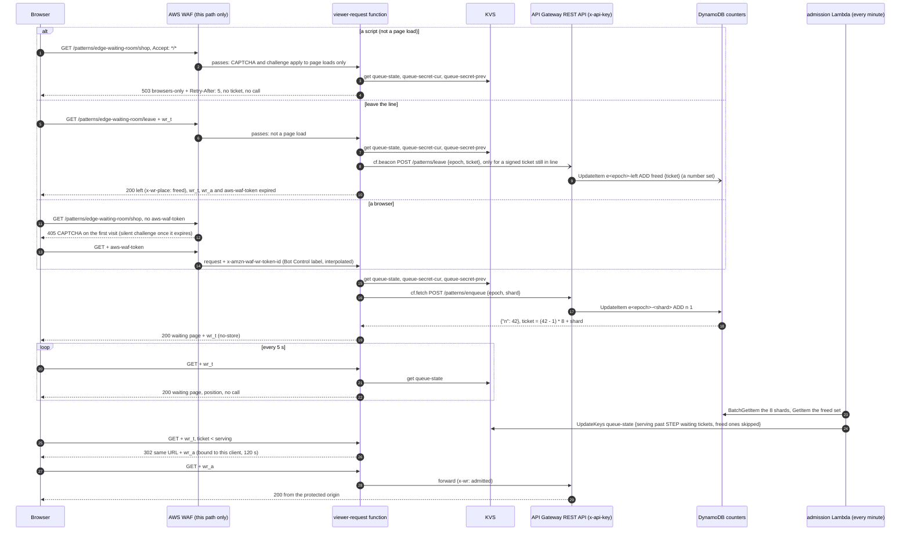

# 11 · edge-waiting-room

A virtual waiting room at the edge: one `cf.fetch` draws a ticket, then every refresh compares a signed cookie with a
watermark in KVS, with no call.

Tags: `resilience` · Hooks: viewer-request · Path: `/patterns/edge-waiting-room/*`

## What it does

A launch spike needs somewhere to wait that isn't your origin. Here the queue is two integers: a **ticket counter** in
DynamoDB and a **watermark** (`serving`) in KVS. A new browser spends the function's one network call to draw a ticket, an
atomic `ADD n 1` through an API Gateway DynamoDB integration (no Lambda). The ticket travels in a signed cookie (an HS256 JWT), so
every refresh after that is a KVS read and a compare, with no call. An admission Lambda raises the watermark once a minute
by `STEP`, the number of viewers the origin can take per minute; a ticket below it gets a short-lived admission cookie and
reaches the origin.

AWS WAF guards the ticket counter, on this path only. A browser's first page load gets one CAPTCHA, and after that WAF's
silent JavaScript challenge: a person solves the puzzle, a script can't, so it never draws a ticket. Bot Control (in count mode, so it
labels and never blocks) gives each browser a token id, and a count rule hands it to the function, which binds the
admission cookie to it.

Unlike [03](../03-bot-check-fail-open/) and [08](../08-origin-health-fallback/), this fails **closed**: the call is the
protection, so when the counter can't be reached nobody gets in.

## Architecture





## Sequence diagram



## The function

Key points:

- **The call is spent once per viewer, never per refresh.** Only a browser page load (`GET` + `Accept: text/html`) without
  a valid cookie draws a ticket. curl, APIs and prefetch get `503` + `Retry-After` and no ticket, so they can't fill the line.
- **The counter is 8 items, not 1.** One DynamoDB item takes about 1,000 writes per second; a launch spike is exactly when
  that matters. The shard is a hash of the request id, not `Math.random()`, because no network call may follow a random
  value. Ordering loosens by at most 8 places.
- **Cookies are HS256 JWTs, and verify with two secrets.** New ones are signed with `queue-secret-cur`;
  `queue-secret-prev` still verifies, so rotating the secret doesn't throw the whole line out. See
  [what the cookies prove](#what-the-cookies-prove).
- **`wr_a` is bound to the client**: the WAF token id that the web ACL's count rule inserts as `x-amzn-waf-wr-token-id`, the user agent, and
  `CloudFront-Viewer-JA4-Fingerprint` (the behavior's origin request policy asks CloudFront for it). A copied cookie fails
  elsewhere; the owner's `wr_t` re-admits them for free.
- **The epoch makes a reset safe.** Tickets and the watermark carry `queue-epoch`; bumping it starts a new line and old
  tickets stop counting, instead of mass-admitting against a high watermark.
- **Every answer from the function is `Cache-Control: no-store`**, because it may carry a ticket. A forwarded request
  (`admitted`, `off`) gets the origin's own answer and headers.

The viewer-request function: [`function.js`](function.js).

## What the cookies prove

Both cookies are compact HS256 JWTs (`header.payload.signature`, base64url), signed with HMAC-SHA256 and the KVS secret,
so any JWT library can read and verify them:

| Cookie | Claims | Lifetime |
|---|---|---|
| `wr_t`, the ticket | `{"epoch": 1, "ticket": 42, "iat": <seconds>}` | `Max-Age` 2 h |
| `wr_a`, the pass | `{"epoch": 1, "exp": <seconds>, "bnd": "<22 chars>"}`, where `bnd` is a SHA-256 of WAF token id, user agent and JA4 | 120 s, checked against `exp` |

- **Signed.** The function accepts exactly one header, `{"alg":"HS256","typ":"JWT"}`, so `alg: none` and every other
  algorithm are refused before anything is decoded. The signature is compared in constant time, against the current
  and the previous secret.
- **Expiring and scoped.** `exp` (seconds) bounds a pass; `epoch` must match `queue-state`, so a new line voids old
  tickets. `HttpOnly`, `Secure`, `SameSite=Lax`, path `/patterns/edge-waiting-room/`.
- **Bound.** `bnd` is a hash, not the values: the payload says nothing about the viewer they didn't send themselves, and a
  pass copied to another client fails.
- **Not encrypted, and that's fine.** A ticket number and an expiry are not secrets, and a viewer reading their own
  cookie learns their place in line, which the page shows anyway. What matters is that nobody can change them. CloudFront
  Functions has HMAC in `crypto`, but no documented encryption.
- **Old cookies.** Cookies from before the JWT format don't verify: their holder simply draws a new ticket.

The runtime handles all of it: `Buffer` with `base64url` both ways, and `crypto` digests to `base64url`, byte for byte the
same as Node. A token minted by Node verified in CloudFront's runtime (TestFunction, 2026-10-27).

## The admission Lambda

[`lambda/admission.mjs`](lambda/admission.mjs) runs once a minute (EventBridge's shortest rate). It reads the operator's
`queue-mode` and `queue-epoch`, sums the 8 counters, and writes one KVS key the function reads:

```json
{"mode": "on", "epoch": 1, "serving": 35, "step": 5, "tick": 1793059200000}
```

`serving` moves past `STEP` tickets that are **still waiting**: tickets freed with `/leave` are skipped, so a departed
place goes to the next person instead of an empty slot. It never passes the tickets actually drawn, so a quiet line can't bank admissions for
the next spike. On its first run it also writes a random `queue-secret-cur`. When `queue-state` is missing (a new, empty
KVS after a deploy) while the DynamoDB counters live on, it starts the watermark at the tickets already drawn, not at 0,
so the line resumes behind them instead of queuing newcomers behind tickets nobody holds any more.

**Leaving frees the place.** `/leave` fires one `cf.beacon` that adds the ticket to a DynamoDB number set (`freed` on
`e<epoch>-left`, through the same API Gateway integration shape as the enqueue, no Lambda). The admission Lambda reads the
set each tick. Only a ticket with a valid signature, of this epoch and not yet admitted, counts, and a set is idempotent:
replaying one cookie frees one place, so nobody can inflate it. The walk past freed tickets is idempotent too, because
tickets below the watermark are never looked at again.

**Ghosts.** A viewer who closes the tab without leaving stays a ticket. When the watermark reaches it, that slot is spent
on nobody, and the waste is bounded by one tick's `STEP`. An admitted viewer who walks away holds nothing for long: `wr_a`
lasts 120 s. The leave beacon is best effort: a dropped one leaves exactly one ghost, and the cookies are cleared either way.

**Demo only: a simulated line.** On a test deployment you are usually alone, so you would be admitted at the next tick and never see
the line move. With `DEMO_LINE` (10 in [`pattern.ts`](pattern.ts)), each tick tops the line up to that many simulated
visitors, as tickets added to the emptiest counter shards. A visitor who joins sees about 10 ahead, then 5, then gets in:
three ticks, about three minutes. The position shown is `ticket - serving + 1`, so simulated tickets never move anyone back. Set
`DEMO_LINE` to 0 for a real launch.

## The AWS WAF rules

[`pattern.ts`](pattern.ts) sets `botControl: true` and contributes three rules. In the distribution's shared web ACL (default action
Allow) they run in this order, each scoped to `/patterns/edge-waiting-room/`, so no other pattern is affected:

| Rule | Action | Why |
|---|---|---|
| `bot-control` (shared, scoped to every pattern with `botControl`) | Bot Control, common level, **count** | its token management labels each request with `awswaf:managed:token:id:<id>`; count, so curl still gets the function's 503 and not a WAF 403 |
| `edge-waiting-room-captcha` | **CAPTCHA** page loads from a browser that has never solved one | see [CAPTCHA first](#captcha-first) |
| `edge-waiting-room-challenge` | **Challenge** page loads (`Accept: text/html`) | after the CAPTCHA has expired, only a client that runs JavaScript keeps a valid token; with one the rule acts like count |
| `edge-waiting-room-token-id` | **count**, insert header `wr-token-id: ${awswaf:managed:token:id:}` | [dynamic label interpolation](https://aws.amazon.com/blogs/security/do-more-with-aws-waf-labels-using-dynamic-label-interpolation/): WAF runs before the function and prefixes the header, so it arrives as `x-amzn-waf-wr-token-id` |

### CAPTCHA first

A silent challenge alone stops scripts, but a headless browser can pass it, and a place in line is worth scalping. So a
browser solves **one CAPTCHA** on its first page load, and the silent challenge takes over once that CAPTCHA expires. Bot Control's token
labels drive it, and they come from the encrypted `aws-waf-token`, so a viewer can't forge them:

| Token label on the page load | Rule that answers |
|---|---|
| `awswaf:managed:captcha:absent` or `awswaf:managed:captcha:rejected:not_solved` (never solved) | CAPTCHA (`405`, `x-amzn-waf-action: captcha`) |
| `awswaf:managed:captcha:rejected:expired` (solved earlier, past its immunity time) | the silent challenge |
| `awswaf:managed:captcha:accepted` | neither: the request goes on to the function |

The function takes no part in it. Two costs: every first visit is a puzzle (WAF's CAPTCHA has an audio option), and each
solved puzzle is a billed WAF CAPTCHA. One solved CAPTCHA can still draw several tickets if its owner drops `wr_t` and keeps the token; a
WAF rate-based rule keyed on the `awswaf:managed:token:id:` label namespace caps page loads per token.

## Prerequisites

Node.js 22+, AWS credentials for the target account, Docker or npm for Lambda bundling, and a CDK-bootstrapped
`us-east-1` (`npx cdk bootstrap aws://<account-id>/us-east-1`). Run `npm ci` once at the repository root.

## Deploy this pattern

```sh
npx cdk deploy -c patterns=edge-waiting-room
```

This deploys the one stack with only this pattern's backend and cache behavior, and the shared web ACL with this
pattern's AWS WAF rules. The `DistributionDomain` output is the `<domain>` used below. To deploy it next to others, list
them: `-c patterns=edge-waiting-room,hello-fetch`.

No manual step follows. The admission Lambda writes `queue-secret-cur` and the first `queue-state` on its first run, so
for the first minute or two (one tick, plus KVS propagation) the page says "The queue is starting". Every deploy creates
a new, empty KVS, so the same happens after each deploy: a new secret voids every old cookie, and the queue resumes
behind the tickets already drawn.

## Try it

Open `https://<domain>/patterns/edge-waiting-room/shop` in a browser tab: a waiting page with your ticket, then your
position. Within about two minutes (one tick, plus the 30-60 s KVS takes to reach the edge, see
[04](../04-ab-global-table/)) the page turns into the protected origin's JSON with `"x-wr": "admitted"`.

```sh
D=https://<domain>/patterns/edge-waiting-room
curl -si $D/shop | grep -iE '^(HTTP|x-wr|retry-after)'                             # 1. not a page load
curl -si -H 'Accept: text/html' $D/shop | grep -iE '^(HTTP|x-amzn-waf-action|x-wr)'  # 2. a page load from a script
```

| Step | Expected |
|---|---|
| 1 | `503`, `x-wr: browsers-only`, `retry-after: 5`, no cookie: the function's answer |
| 2 | `405`, `x-amzn-waf-action: captcha`: WAF's CAPTCHA, which curl can't solve, so no ticket |
| Browser | the waiting page (`x-wr: queued`, then `waiting`), then a `302` (`x-wr: admit`) and the origin's JSON |

Operator knobs, all in the shared KVS (picked up at the next tick):

```sh
KVS=$(aws cloudformation describe-stacks --stack-name FoundationStack \
  --query "Stacks[0].Outputs[?OutputKey=='KeyValueStoreArn'].OutputValue" --output text)
ETAG=$(aws cloudfront-keyvaluestore describe-key-value-store --kvs-arn $KVS --query ETag --output text)
aws cloudfront-keyvaluestore put-key --kvs-arn $KVS --if-match $ETAG --key queue-mode --value off   # or on
```

`queue-epoch` (a positive integer) starts a new line. To rotate the secret, copy `queue-secret-cur` to `queue-secret-prev`,
then write a new `queue-secret-cur`.

## How it fails

| What goes wrong | The viewer gets | `x-wr` |
|---|---|---|
| Not a browser page load, no cookie | `503` + `Retry-After: 5`, no ticket | `browsers-only` |
| A first page load (no CAPTCHA solved yet), or any page load from a script | `405` CAPTCHA from WAF; the function never runs. Once a person solves it, the page loads and draws a ticket | none, then `queued` |
| A page load after the CAPTCHA expired, from a client that can't run JavaScript | `202` silent challenge from WAF | none |
| The enqueue call fails: API Gateway throttles (429), DynamoDB errors, timeout | waiting page without a ticket, retries in 5 s; nothing reaches the origin | `busy` |
| The admission Lambda stops (no tick for 5 minutes) | waiting page "paused", place kept | `paused` |
| No `queue-state` or no secret yet (first deploy, or the new KVS after a deploy) | waiting page "starting" | `starting` |
| A forged, foreign-secret or old-epoch cookie | treated as no cookie: a script gets `503` `browsers-only`, a page load the CAPTCHA; a new ticket only after a solved CAPTCHA | `queued` |
| `wr_a` copied to another client | not admitted; treated as a newcomer, as above | `queued` |
| `wr_a` expired, `wr_t` still valid | a new `wr_a`, no call | `admit` |
| `queue-mode` is `off` | forwarded, no checks | `off` |
| `GET /patterns/edge-waiting-room/leave` (the waiting page links to it) | `200`; `wr_t`, `wr_a` and `aws-waf-token` expired, so the next page load starts over at the CAPTCHA. A signed ticket still in line is freed with one `cf.beacon` (`x-wr-place: freed`); no ticket, a forged one, or one already admitted frees nothing (`none`) | `left` |

## Cost

A first page load costs one CloudFront request, one CloudFront Functions invocation with three KVS reads, one network
call, one API Gateway REST API request and one DynamoDB on-demand write. Every refresh after that is a CloudFront request
and a function invocation with KVS reads, and no call. An admitted request adds one API Gateway request to the mock
origin; `/leave` adds one `cf.beacon`, one API Gateway request and one DynamoDB write.

AWS WAF bills on every request the distribution serves, plus Bot Control per request it inspects (scoped to this path),
each CAPTCHA and Challenge attempt, and each solved puzzle is a billed CAPTCHA.

Billed while idle:

- the AWS WAF web ACL and its rules, monthly, and the Bot Control rule group's subscription;
- the admission Lambda, run every minute by EventBridge whether or not anyone waits: each tick reads the counters in
  DynamoDB and writes `queue-state` through the KVS API, and with `DEMO_LINE` above 0 it also writes simulated tickets;
- the Secrets Manager secret that holds the API key, and the table's storage.

API Gateway and the on-demand table bill per request. See [CloudFront pricing](https://aws.amazon.com/cloudfront/pricing/),
[AWS WAF pricing](https://aws.amazon.com/waf/pricing/), [API Gateway pricing](https://aws.amazon.com/api-gateway/pricing/),
[DynamoDB pricing](https://aws.amazon.com/dynamodb/pricing/), [Lambda pricing](https://aws.amazon.com/lambda/pricing/),
[EventBridge pricing](https://aws.amazon.com/eventbridge/pricing/) and
[Secrets Manager pricing](https://aws.amazon.com/secrets-manager/pricing/).

## Security

- The origin is an API Gateway REST API where every method requires an API key. CloudFront sends it as the `x-api-key`
  custom origin header, generated in Secrets Manager, on every origin request, the `cf.fetch` and `cf.beacon` calls
  included. A request to the API's own URL without the key is refused with 403. The stage throttle caps it at 3,000
  requests per second.
- API Gateway writes to DynamoDB with its own IAM role, allowed only `UpdateItem` on the counters table; the function holds
  no AWS credentials. The admission Lambda may read and update the table, and read and update keys in this KVS.
- AWS WAF answers page loads on this path with a CAPTCHA, then the silent challenge, before the function runs; see
  [The AWS WAF rules](#the-aws-waf-rules). The token id header is inserted by WAF, with its `x-amzn-waf-` prefix.
- The function deletes any viewer-sent `x-wr`: only it tells the origin what happened. The origin request policy forwards
  only `x-wr` and `CloudFront-Viewer-JA4-Fingerprint`: no cookies, no query strings, no `Host`.
- The cookies are signed HS256 JWTs, verified in constant time, and `wr_a` is bound to the client; see
  [what the cookies prove](#what-the-cookies-prove). Every answer from the function is `Cache-Control: no-store`.
- It fails **closed**. If the enqueue call fails, or there is no `queue-state` or secret yet, the viewer gets a waiting
  page and nothing reaches the origin: the call is the protection, so failing open would let a spike straight through.
  Only `queue-mode` `off`, an operator's choice, forwards without checks. The leave beacon is best effort.
- **The API key is visible.** CDK unwraps it at deploy time, so its value is in the CloudFormation template and the
  distribution's custom-header configuration; anyone who can read either can call the API directly. Keep the usage plan
  throttling, restrict who can read the stack and distribution, and rotate the key together with the CloudFront header.

## Limits and notes

- **`wr_a` is a bearer token, narrowed.** Bound to the WAF token id, the user agent and JA4, a copied cookie fails in
  another browser. The token id can change when a browser gets a new token; its `wr_t` then re-admits it, with no call.
  Without the web ACL the binding falls back to the user agent and JA4, which clients with an identical TLS stack share.
  Strict one-admission-per-ticket needs a call on every admitted request: use the [Virtual Waiting Room on AWS](https://aws.amazon.com/solutions/implementations/virtual-waiting-room-on-aws/) solution.
- **`wr_t` is not bound to the client.** Only `wr_a` is. A copied `wr_t` is admitted from another client, a script
  included, for its 2 h lifetime: the function checks for a page load only when there is no ticket, and WAF's CAPTCHA
  and challenge gate only page loads. Treat the ticket as a bearer token, or bind it the way `wr_a` is.
- **Per ticket, not per human.** One browser keeps one ticket (the cookie), but several browsers draw several.
- **Admission moves in steps.** One tick a minute, then 30-60 s of KVS propagation: expect a minute or two between ticks
  reaching the edge.
- **Capacity.** The stage throttle (3,000 enqueues per second) sits below a new on-demand table's 4,000 writes per second,
  so nothing throttles at minute zero. For more, pre-warm the table (warm throughput, billed, can't be lowered) and raise
  the throttle and the shard count together (`SHARDS` in `function.js` and `lambda/admission.mjs`).
- **The binding holds, observed live.** Bot Control at the common level emits the token id label: every request carrying
  an `aws-waf-token` matched the token-id rule, with `x-amzn-waf-wr-token-id` inserted. The function also sees
  `CloudFront-Viewer-JA4-Fingerprint`. A curl replay of a browser's `wr_a` and `aws-waf-token`, with the same user agent,
  was refused while the same cookie still admitted the browser: only the TLS fingerprint differed.
- **A long session is challenged again.** The Challenge rule's immunity time (300 s by default) runs out during a long
  admitted session, so a later page load gets WAF's challenge again. The browser solves it silently, and its `wr_t`
  re-admits it with a new `wr_a`, so it keeps its place. Raise the web ACL's challenge immunity time if that matters.
- **Fixed pacing is the safe default.** `STEP` ignores viewers who gave up. Sampled heartbeats or origin health (p95, 5xx)
  can raise utilisation; both add a second system.
- **Why not call DynamoDB directly?** The function can't sign SigV4 and origin access control doesn't cover DynamoDB; a
  hand-rolled signature would need static IAM keys in the function. API Gateway holds the role.
- **Why not SQS as the queue?** It gives nobody a position, and something would have to receive and delete every message
  just to say "come in".

Files:

- `pattern.ts`: the counters table, the API (enqueue integration, the mock protected origin, the stage throttle), the
  admission Lambda and its schedule, the origin request policy, the AWS WAF rules
- `function.js`: the viewer-request function
- `lambda/admission.mjs`, `lambda/index.mjs`, `lambda/kvs.mjs`: the admission logic, its AWS wiring, the KVS client
- `test/`: unit tests for the function and the admission logic, `node --test patterns/11-edge-waiting-room/test/*.test.mjs`
- `architecture.png`: drawn from the Mermaid block under Architecture by `npm run diagrams`

## Clean up

```sh
npx cdk destroy
```

This deletes the stack: the distribution, the shared web ACL, the KVS, and this pattern's counters table, API Gateway API
and API key, API key secret, admission Lambda and its EventBridge schedule, origin request policy, and the default-behavior bucket.

CloudWatch Logs log groups outlive the stack: Lambda creates `/aws/lambda/<function>` on first use, and CloudFront Functions
log to `/aws/cloudfront/function/<function>` in `us-east-1`. Delete them by hand if you do not want to keep the logs.
